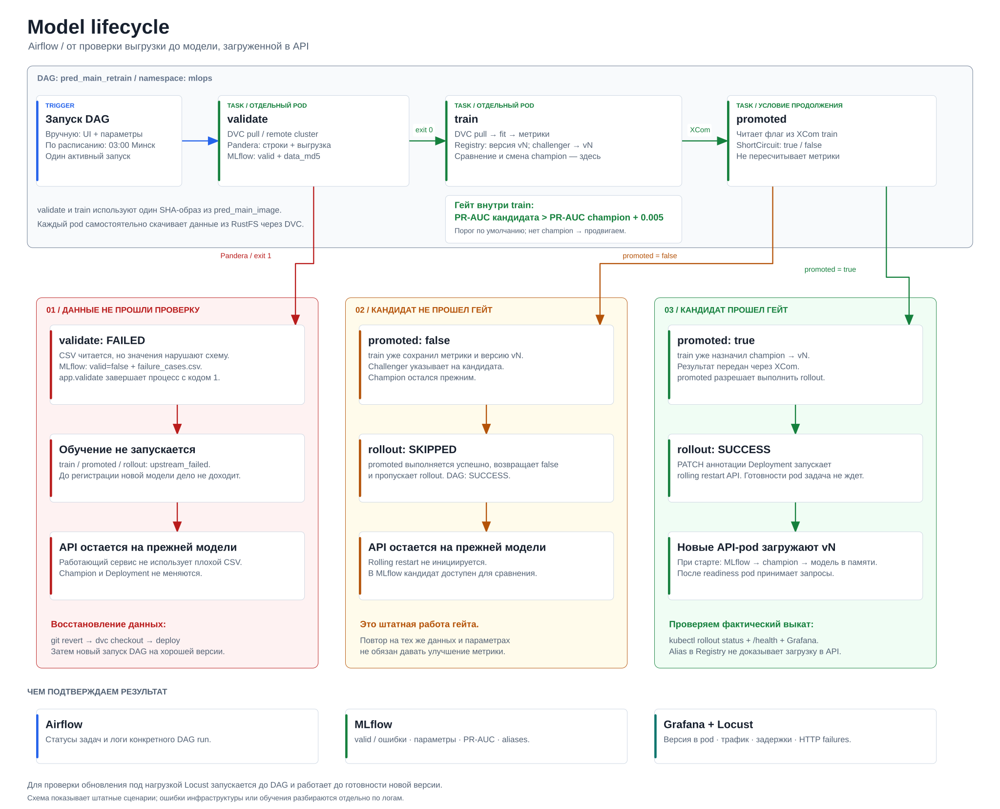
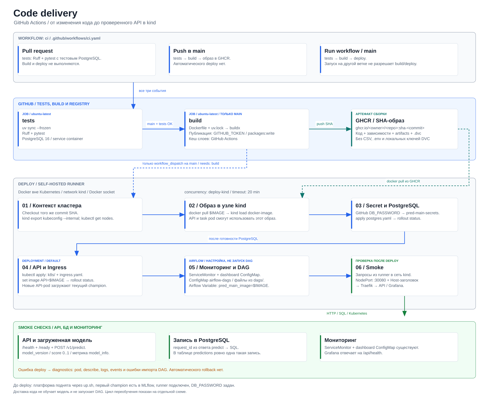
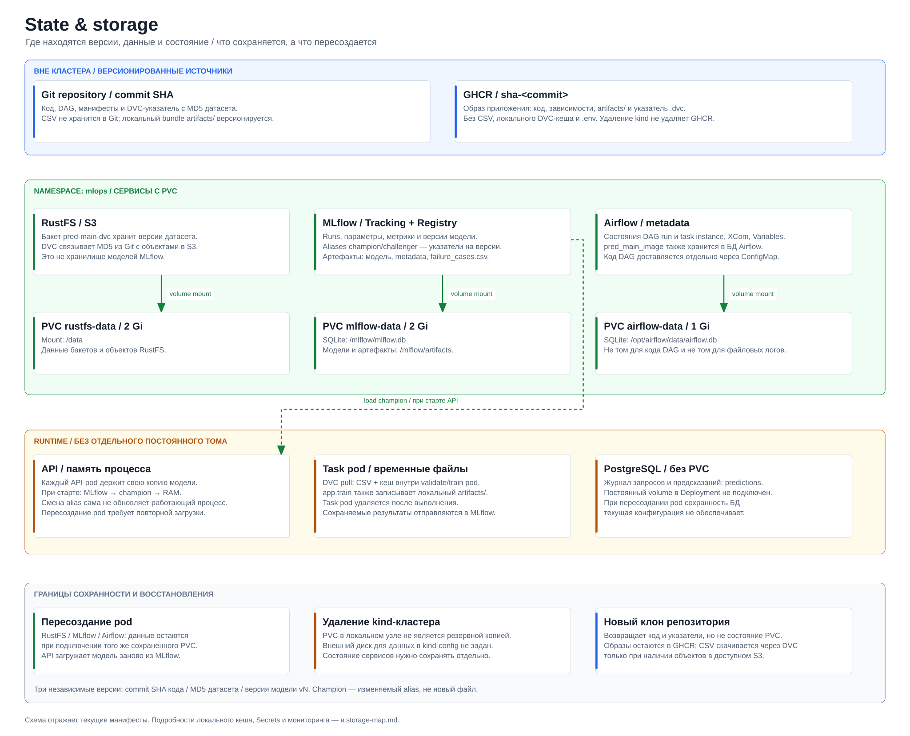

<div align="center">

# Predictive Maintenance MLOps

**От версии данных до новой модели в Kubernetes.**

Прогнозирование отказов оборудования с проверкой данных, автоматическим переобучением и контролируемой доставкой моделей под нагрузкой.

[Quickstart](#quickstart) · [Архитектура](#архитектура) · [Результаты](#результаты)

</div>

## О проекте

Сервис оценивает вероятность отказа промышленного оборудования по температуре, оборотам, крутящему моменту, износу инструмента и типу оборудования. В основе — RandomForest на датасете AI4I 2020, FastAPI и воспроизводимый MLOps-конвейер.

- **Версионирование данных:** DVC хранит указатели в Git, RustFS — сами выгрузки в S3.
- **Контроль качества:** Pandera проверяет строки и выгрузку целиком, блокирует обучение на некорректных данных и сохраняет ошибки в MLflow.
- **Управление моделями:** MLflow связывает параметры, метрики, артефакты и версии; кандидат получает alias `champion` только после прохождения гейта по PR-AUC.
- **Доставка:** GitHub Actions собирает SHA-образ приложения, Airflow управляет переобучением и rolling restart API при смене champion.
- **Наблюдаемость:** Prometheus и Grafana показывают трафик, задержки, ошибки и версии моделей; Locust проверяет работу сервиса во время выката.

## Стек

<p align="center">
  <a href="https://www.python.org/"></a>
  <a href="https://fastapi.tiangolo.com/"></a>
  <a href="https://scikit-learn.org/"></a>
  <a href="https://www.postgresql.org/"></a>
  <a href="https://mlflow.org/"></a>
  <a href="https://dvc.org/"></a>
</p>

<p align="center">
  <a href="https://www.docker.com/"></a>
  <a href="https://kubernetes.io/"></a>
  <a href="https://helm.sh/"></a>
  <a href="https://traefik.io/traefik"></a>
  <a href="https://github.com/features/actions"></a>
  <a href="https://airflow.apache.org/"></a>
</p>

<p align="center">
  <a href="https://prometheus.io/"></a>
  <a href="https://grafana.com/oss/grafana/"></a>
  <a href="https://docs.pytest.org/"></a>
  <a href="https://docs.astral.sh/uv/"></a>
  <a href="https://docs.astral.sh/ruff/"></a>
  
</p>

Также в платформе: **Pandera · kind · RustFS (S3) · GHCR · Locust**.

## Quickstart

Полный запуск из свежего клона в новом kind-кластере проверен на Windows с Docker Desktop, включая deploy API и переобучение через Airflow.

### Перед запуском

Установи инструменты по официальным инструкциям. `up.sh` использует их, но не устанавливает на компьютер.

| Инструмент | Установка |
| --- | --- |
| Git; на Windows — Git Bash | [Git](https://git-scm.com/downloads/) · [Git for Windows](https://gitforwindows.org/) |
| Python 3.11 или 3.12 | [Python](https://www.python.org/downloads/) |
| uv | [uv](https://docs.astral.sh/uv/getting-started/installation/) |
| Docker Desktop / Docker Engine | [Docker Desktop](https://docs.docker.com/desktop/) · [Linux Engine](https://docs.docker.com/engine/install/) |
| kind | [kind](https://kind.sigs.k8s.io/docs/user/quick-start/#installation) |
| kubectl | [kubectl](https://kubernetes.io/docs/tasks/tools/) |
| Helm | [Helm](https://helm.sh/docs/intro/install/) |
| curl с поддержкой `--aws-sigv4` | [curl](https://curl.se/download.html) |

Дополнительно: [k9s](https://k9scli.io/topics/install/) для просмотра pod и логов.

Для полного CI/CD-маршрута сделай **Fork**, включи в нем **Actions** и клонируй свой репозиторий. Все команды ниже выполняются **из корня клона в Bash**: Windows — **Git Bash**, Linux — **Bash**. Команды CMD для hosts помечены отдельно. Docker должен работать в режиме Linux-контейнеров; порт **80** должен быть свободен. Текущий workflow deploy и runner рассчитаны на **x64**.

<details>
<summary>Проверить установленные инструменты</summary>

```bash
git --version
uv --version
docker info
kind version
kubectl version --client
helm version
curl --help all | grep -- --aws-sigv4
```

Команды должны выполняться без ошибок, последняя — показывать `--aws-sigv4`.

</details>

### 1. Настроить локальные адреса

Сервисы доступны через `*.localhost`. Добавь имена в hosts **один раз**; существующие записи с другим IP исправь, а не дублируй.

**Windows — CMD от имени администратора:**

```bat
echo.>> C:\Windows\System32\drivers\etc\hosts
echo 127.0.0.1 mlflow.localhost airflow.localhost grafana.localhost pred-main.localhost s3.localhost s3-console.localhost>> C:\Windows\System32\drivers\etc\hosts
ipconfig /flushdns
```

**Linux/macOS — терминал:**

```bash
printf '\n127.0.0.1 mlflow.localhost airflow.localhost grafana.localhost pred-main.localhost s3.localhost s3-console.localhost\n' | sudo tee -a /etc/hosts
```

<details>
<summary>Ручная настройка hosts и кеш DNS на macOS</summary>

На Windows можно открыть `C:\Windows\System32\drivers\etc\hosts` в Блокноте от администратора и добавить ту же строку вручную. Сохрани файл без расширения `.txt`.

На macOS после изменения `/etc/hosts` сбрось кеш DNS:

```bash
sudo dscacheutil -flushcache
sudo killall -HUP mDNSResponder
```

Это настройка адресов; полный deploy на macOS отдельно не проверялся.

</details>

### 2. Поднять платформу

**Из корня репозитория в Bash; на Windows — в Git Bash:**

```bash
bash platform/up.sh
```

Скрипт создает kind-кластер, устанавливает MLflow, RustFS, Airflow, Traefik, Prometheus, Grafana и metrics-server, затем создает бакет `pred-main-dvc`. Повторный запуск обновляет существующую платформу.

Настройки берутся из `.env.example`; значения из `.env`, если он есть, имеют приоритет. Для своих стартовых S3-ключей создай `.env` **до запуска**. При повторном запуске используй прежние ключи: изменение файла не выполняет ротацию credentials работающего хранилища.

**Результат:** сообщение «Платформа готова» и готовые поды:

```bash
kubectl get pods -A
```

| Сервис | Адрес | Доступ по умолчанию |
| --- | --- | --- |
| MLflow | http://mlflow.localhost | Без авторизации |
| Airflow | http://airflow.localhost | В логах: `kubectl -n mlops logs deploy/airflow` |
| Grafana | http://grafana.localhost | `admin` / `admin` |
| RustFS | http://s3-console.localhost/rustfs/console/index.html | `admin` / `admin123` |

Эти credentials предназначены для локального запуска; не публикуй платформу с ними в интернете. API и PostgreSQL будут развернуты на шаге 7.

### 3. Подготовить окружение и доступ к S3

```bash
uv sync --frozen
test -f .env || cp .env.example .env
set -a; source .env.example; source .env; set +a
uv run python -c "import socket; print(socket.gethostbyname('s3.localhost')); print(socket.gethostbyname('mlflow.localhost'))"
```

**Результат:** зависимости установлены, проверка адресов выводит две строки `127.0.0.1`. Если нет — проверь hosts из шага 1.

Настрой локальный DVC теми же S3-ключами, с которыми запущен RustFS:

```bash
uv run dvc remote modify --local laptop access_key_id "$S3_ACCESS_KEY"
uv run dvc remote modify --local laptop secret_access_key "$S3_SECRET_KEY"
```

Ключи сохраняются в игнорируемом `.dvc/config.local`. Настройка сервера через `up.sh` не настраивает клиент DVC на ноутбуке. Продолжай в этом терминале; в новом повтори строку `set -a; source .env.example; source .env; set +a`.

### 4. Загрузить данные

**Для нового пустого бакета:** раскрой блок ниже, выполни подготовку CSV, затем загрузи его в S3.

<details>
<summary>Скачать AI4I 2020 из UCI и воспроизвести датасет проекта</summary>

```bash
uv run python - <<'PY'
import hashlib
import io
from pathlib import Path
import urllib.request
import zipfile
import pandas as pd

url = "https://archive.ics.uci.edu/static/public/601/ai4i+2020+predictive+maintenance+dataset.zip"
with urllib.request.urlopen(url, timeout=60) as response:
    archive = zipfile.ZipFile(io.BytesIO(response.read()))
    name = next(n for n in archive.namelist() if n.endswith("ai4i2020.csv"))
    df = pd.read_csv(archive.open(name))

df = df.loc[df["RNF"] == 0].copy()
df.insert(5, "Temperature delta [K]",
          (df["Process temperature [K]"] - df["Air temperature [K]"]).round(1))
content = df.to_csv(index=False, lineterminator="\r\n").encode("utf-8")
expected = "5d9ee05b71518e3e7e71e6e60c7da425"
assert hashlib.md5(content).hexdigest() == expected, "MD5 mismatch: stop here"
Path("data/raw/ai4i2020.csv").write_bytes(content)
print("Rows:", len(df), "MD5:", expected)
PY
```

**Результат:** 9981 строка, 567521 байт и MD5 `5d9ee05b71518e3e7e71e6e60c7da425`. CSV записывается в UTF-8 с окончаниями строк CRLF независимо от ОС. Если проверка хеша не прошла, не выполняй следующие команды.

</details>

```bash
uv run dvc commit data/raw/ai4i2020.csv.dvc
uv run dvc push -r laptop data/raw/ai4i2020.csv.dvc
uv run dvc status
```

**Результат:** данные в S3, DVC сообщает об актуальном состоянии. `dvc commit` заполняет локальный кеш, а не создает Git-коммит. MD5 в `.dvc` менять не нужно: мы воспроизводим ту же версию данных.

**Если датасет уже есть в S3**, вместо подготовки и загрузки скачай его:

```bash
uv run dvc pull -r laptop data/raw/ai4i2020.csv.dvc
```

### 5. Создать первого champion

```bash
export MLFLOW_TRACKING_URI=http://mlflow.localhost
export PYTHONIOENCODING=utf-8
uv run python -m app.validate
uv run python -m app.train
```

**Результат:** в MLflow зарегистрирована модель `predictive-maintenance` с alias `champion`. Локальное обучение отправляет модель в MLflow кластера; при старте API загрузит ее по внутреннему адресу MLflow. Последующие переобучения выполняет Airflow.

### 6. Подключить runner

В своем репозитории GitHub:

1. **Settings → Secrets and variables → Actions → New repository secret:** создай `DB_PASSWORD` со значением из `.env` (по умолчанию `postgres`).
2. **Settings → Actions → Runners → New self-hosted runner → Linux x64:** получи registration token.
3. Запусти runner на компьютере с kind:

```bash
read -r -p "HTTPS URL вашего репозитория на GitHub: " REPO_URL
read -r -s -p "Runner registration token: " RUNNER_TOKEN
echo
export REPO_URL RUNNER_TOKEN
MSYS_NO_PATHCONV=1 docker run -d --name gh-runner --network kind \
  -w /home/runner --group-add 0 \
  -v /var/run/docker.sock:/var/run/docker.sock \
  -e REPO_URL -e RUNNER_TOKEN \
  ghcr.io/actions/actions-runner:2.337.0 \
  bash -lc './config.sh --url="$REPO_URL" --token="$RUNNER_TOKEN" --name=pred-main-runner --labels=kind --unattended && exec ./run.sh'
unset RUNNER_TOKEN
docker logs --tail 30 gh-runner
```

**Результат:** `Listening for Jobs` в логах, runner в состоянии `Idle` с меткой `kind` в GitHub. Если `gh-runner` уже существует, используй настроенный runner вместо повторного создания.

Runner имеет доступ к Docker хоста. Подключай его только к своему репозиторию и выполняй на нем доверенный код.

### 7. Развернуть API

В GitHub открой **Actions → ci → Run workflow → main**. Дождись успешного завершения `tests`, `build` и `deploy`.

Workflow сам собирает образ из Dockerfile, публикует его в GHCR твоего репозитория, загружает в kind и разворачивает PostgreSQL и API. Тот же SHA-образ записывается в Airflow Variable `pred_main_image` для задач `validate` и `train`. Собирать образ вручную не нужно.

```bash
curl --fail http://pred-main.localhost/health
curl --fail http://pred-main.localhost/ready
curl --fail -H "Content-Type: application/json" \
  --data-binary @good.json http://pred-main.localhost/v1/predict
```

**Результат:** health показывает `predictive-maintenance:v…@champion`, ready отвечает успешно, predict возвращает `score` от 0 до 1 и `request_id`. Workflow также проверяет запись запроса в PostgreSQL.

Если менял имя `CLUSTER`, задай такое же имя в `KIND_CLUSTER` в [.github/workflows/ci.yaml](.github/workflows/ci.yaml).

### 8. Запустить переобучение в Airflow

Открой [Airflow](http://airflow.localhost), войди с credentials из логов `kubectl -n mlops logs deploy/airflow` и найди DAG **`pred_main_retrain`**. Он появляется после deploy; обновление списка может занять минуту-две.

1. Включи DAG переключателем рядом с его названием, если он на паузе.
2. Открой DAG и нажми **Trigger / Запустить**.
3. В форме параметров задай значения ниже и подтверди запуск. Менять `train.py` или пересобирать образ для подбора этих параметров не нужно.

```json
{
  "n_estimators": 300,
  "max_depth": null,
  "min_samples_leaf": 2
}
```

В открывшемся запуске отслеживай цепочку **`validate → train → promoted → rollout`**. Логи каждой задачи доступны по нажатию на нее.

| Задача | Что происходит | Ожидаемый результат |
| --- | --- | --- |
| `validate` | Отдельный pod скачивает данные из S3 и проверяет их через Pandera | Успех; в MLflow у запуска `validate` тег `valid=true` |
| `train` | Отдельный pod обучает кандидата с заданными параметрами и сравнивает с champion | Успех; параметры, метрики и версия кандидата в MLflow |
| `promoted` | Проверяет решение гейта по PR-AUC | Успех задачи означает выполнение проверки, а не обязательно продвижение модели |
| `rollout` | При продвижении инициирует rolling restart API для загрузки нового champion | Успех при продвижении; `Skipped / Пропущен`, если улучшения недостаточно |

**Результат:** при улучшении PR-AUC более чем на `0.005` меняется champion и выполняется rollout. Если модель не стала лучше, DAG завершается успешно с пропущенным rollout: это штатная работа гейта. На неизменных данных с теми же параметрами повторный запуск не обязан улучшать модель.

После продвижения дождись готовности API и проверь загруженную версию:

```bash
kubectl rollout status deployment/predictive-maintenance-api --timeout=180s
curl --fail http://pred-main.localhost/health
```

**Проверка под нагрузкой**

Для проверки доступности во время обновления сначала запусти Locust, затем повтори запуск DAG:

```bash
uv run locust -f load/locustfile.py --host http://pred-main.localhost
```

Открой http://localhost:8089, задай **5 пользователей**, **spawn rate 1** и запусти трафик. Не останавливай его до окончания выката. В [Grafana](http://grafana.localhost) наблюдай версию модели, RPS, задержки и HTTP-ошибки; в Locust — число запросов и failures. При реальном продвижении версия должна смениться, а запросы продолжить выполняться без ошибок. Если гейт не пропустил кандидата, версия останется прежней — смену версии такой прогон не проверяет.

## Архитектура

### Платформа

[](docs/architecture/architecture.svg)

[Открыть SVG](docs/architecture/architecture.svg) · [Исходник Excalidraw](docs/architecture/architecture.excalidraw)

GitHub Actions доставляет код и SHA-образ через self-hosted runner в kind. Airflow запускает проверку и обучение в отдельных pod; после продвижения кандидата инициирует rolling restart API. API загружает `champion` из MLflow **при старте**, а предсказания выполняет моделью в памяти, без обращения к MLflow на каждый запрос.

### Жизненный цикл модели

[](docs/architecture/model-lifecycle.svg)

[Открыть SVG](docs/architecture/model-lifecycle.svg) · [Исходник Excalidraw](docs/architecture/model-lifecycle.excalidraw)

Невалидная выгрузка останавливает обучение; кандидат без достаточного улучшения сохраняется в MLflow, но не меняет работающий сервис. При прохождении гейта `train` обновляет alias `champion`, а `promoted` разрешает задачу `rollout`.

Успех `rollout` означает, что rolling restart инициирован. Фактическое завершение обновления проверяется отдельно: готовность Deployment, версия в `/health` и Grafana, отсутствие ошибок в Locust во время выката.

### Доставка кода

[](docs/architecture/code-delivery.svg)

[Открыть SVG](docs/architecture/code-delivery.svg) · [Исходник Excalidraw](docs/architecture/code-delivery.excalidraw)

Pull request запускает тесты; push в `main` дополнительно собирает и публикует SHA-образ. Deploy выполняется только при ручном запуске workflow на `main`: self-hosted runner загружает образ в kind, разворачивает БД и API, обновляет мониторинг, DAG и `pred_main_image`, затем проверяет сервис реальными запросами и записью в PostgreSQL.

Доставка кода не запускает обучение: API загружает текущий `champion`, а переобучение выполняется отдельным запуском Airflow DAG.

### Где что хранится

Код, датасет и модель имеют независимые идентификаторы: commit SHA, MD5 и версию Registry. Git хранит код и указатели, RustFS — датасеты, PVC MLflow — эксперименты и модели. Загруженная модель API находится в памяти процесса.

<details>
<summary>Карта хранения и границы сохранности</summary>

[](docs/architecture/state-storage.svg)

[Открыть SVG](docs/architecture/state-storage.svg) · [Исходник Excalidraw](docs/architecture/state-storage.excalidraw)

PVC — запрос Kubernetes на постоянное хранилище, подключаемое к pod. Данные сохраняются при подключении того же сохраненного тома, но PVC не является резервной копией локального kind-кластера. PostgreSQL в текущей конфигурации работает без PVC; кеш task-pod и модель в памяти API также не являются постоянным хранилищем.

</details>

[Таблица хранилищ, путей и восстановления](docs/architecture/storage-map.md)

## Результаты

### Итоговый отчет

**[Отчет о работе платформы](REPORT.md)** — таблица доказательств, ссылки на CI/CD-прогоны и коммиты, метрики и скриншоты экспериментов.

Проверены три сценария переобучения: продвижение улучшенной модели под трафиком, отклонение кандидата гейтом и остановка конвейера на некорректной выгрузке с последующим восстановлением данных. Полный запуск платформы, API и Airflow воспроизведен на Windows в новом кластере из свежего клона.

[Доказательства по заданию](REPORT.md#1-доказательства-по-заданию) · [Сценарии Airflow](REPORT.md#35-конвейер-переобучения-в-airflow) · [Ответы на восемь вопросов](REPORT.md#7-восемь-вопросов)

<details>
<summary>Дополнительные материалы проекта</summary>

- [MLflow, Model Registry, DVC и CI/CD](reports/hw3/REPORT.md)
- [Развертывание и проверки сервиса](reports/hw2/REPORT.md)
- [Модель и API](reports/hw1/REPORT.md)

</details>
