# Отчет: Predictive Maintenance MLOps

Сервис прогнозирует отказы оборудования по данным AI4I 2020. Проверены доставка приложения в kind, хранение данных в S3, валидация Pandera и переобучение через Airflow с гейтом по PR-AUC.

[Доказательства](#1-доказательства-по-заданию) · [Архитектура и хранение](#2-схема-системы-и-хранение) · [Результаты](#3-результаты-по-блокам-задания) · [Прогоны](#4-прогоны-и-коммиты) · [Переделки](#6-переделки) · [Что не закрыто](#7-что-не-закрыто) · [Вопросы](#8-восемь-вопросов)

## 1. Доказательства по заданию

Проверки базовой части ДЗ4. Подробные результаты приведены ниже в том же порядке.

| Пункт задания | Доказательство |
| --- | --- |
| **1. Платформа одной командой:** Quickstart, все pod Running, время запуска с нуля | [Quickstart](README.md#quickstart), [up.sh](platform/up.sh), [поды платформы](reports/hw4/get-pods.png), [зеленый deploy](https://github.com/vladgulchenko/predictive-maintenance-mlops/actions/runs/39156310968). На Windows запуск с нуля занял примерно 5–10 минут при заранее установленных инструментах. |
| **2. Метрики и дашборд:** RPS, p50/p95, панели модели и версия под трафиком | [Дашборд](reports/hw4/grafana-overview.png), [Locust](reports/hw4/locust-statistics.png). Показатели и ограничение панели score — в [разделе 3.2](#32-метрики-и-дашборд). |
| **3. DVC и S3:** указатель в Git, скрин бакета, только .dvc в образе | [Указатель](data/raw/ai4i2020.csv.dvc), [бакет RustFS](reports/hw4/rustfs-bucket.png), [содержимое API-контейнера](reports/hw4/.dvc_in_container.png). Содержимое контейнера из GHCR-образа проверено через `kubectl exec`; способ проверки описан в разделе 3.3. |
| **4. Pandera:** зеленый CI, valid=false и открытый failure_cases.csv | [Tests job](https://github.com/vladgulchenko/predictive-maintenance-mlops/actions/runs/38957337197/job/117163397508), [pytest](reports/hw4/pytest_step.png), [неуспешный validate](reports/hw4/validate-run.png), [failure_cases.csv](reports/hw4/validate-artifact.png). |
| **5. Airflow:** три сценария DAG, Registry с Aliases, переключение версии и трафик без ошибок | [Продвижение](reports/hw4/dag.png), [отказ гейта](reports/hw4/dag_not_promoted.png), [плохая выгрузка](reports/hw4/airflow_after_bad_data.png), [смена версии](reports/hw4/grafana-in-rollout.png), [Locust при выкате](reports/hw4/locust-statistics-rollout.png). После повторного развертывания сохранены [Registry с Aliases](reports/hw4/mlflow_aliases.png) и [успешный Graph](reports/hw4/airflow-graph.png). [Контрольный повтор 25 октября](#контрольный-повтор-25-октября-api-при-плохой-выгрузке) подтверждает HTTP 200 с прежней моделью после отказа validate. |
| **6. CI/CD:** зеленый прогон с runner и шагами deploy | [Прогон 39156310968](https://github.com/vladgulchenko/predictive-maintenance-mlops/actions/runs/39156310968), [deploy job с шагами runner info, service, monitoring and DAG, smoke](https://github.com/vladgulchenko/predictive-maintenance-mlops/actions/runs/39156310968/job/117760378407). Все три job завершились успешно. |

## 2. Схема системы и хранение

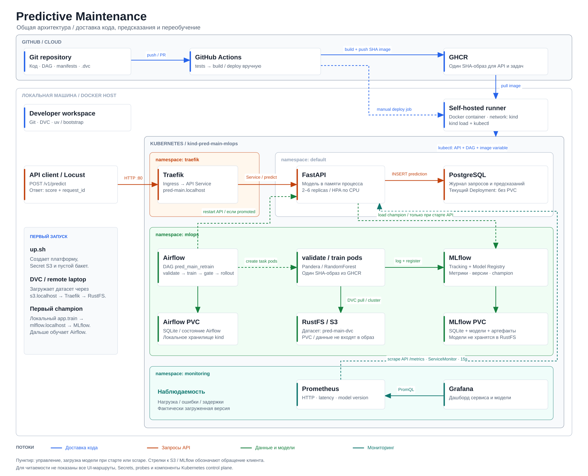

GitHub Actions собирает SHA-образ и доставляет его через self-hosted runner в kind. Airflow запускает проверку и обучение в отдельных pod; после прохождения гейта обновляется alias `champion` и инициируется rolling restart API. API загружает модель из MLflow при старте, выполняет предсказания в памяти и записывает запросы в PostgreSQL. Prometheus опрашивает `/metrics`, Grafana показывает технические и модельные показатели.

| Что хранится | Где | Как найти нужную версию |
| --- | --- | --- |
| Код, DAG и манифесты | GitHub | Commit SHA |
| Датасеты | RustFS, бакет `pred-main-dvc`; PVC `mlops/rustfs-data` | MD5 в `data/raw/ai4i2020.csv.dvc` и параметре MLflow `data_md5` |
| Модели, metadata, артефакты и реестр | PVC `mlops/mlflow-data`: SQLite `/mlflow/mlflow.db`, файлы `/mlflow/artifacts` | Версия Registry → run_id → параметры и артефакты |
| Образы приложения | GHCR; копия в узле kind | Тег `sha-<commit>`; этот же образ используют API и задачи Airflow |
| Логи запросов | PostgreSQL, таблица `predictions` | `request_id`, версия модели, признаки, score и status_code |
| История задач Airflow | PVC `mlops/airflow-data`, SQLite `/opt/airflow/data/airflow.db` | DAG ID, Run ID, задачи и XCom |

PostgreSQL в текущем Kubernetes-манифесте не подключает PVC: пересоздание его pod может удалить журнал запросов. PVC сервисов сохраняют данные при повторном подключении того же тома, но не являются резервной копией удаленного kind-кластера.

Дополнительно: [жизненный цикл модели](docs/architecture/model-lifecycle.svg), [доставка кода](docs/architecture/code-delivery.svg), [карта хранения и восстановления](docs/architecture/storage-map.md).

## 3. Результаты по блокам задания

### 3.1. Платформа одной командой

[platform/up.sh](platform/up.sh) поднимает kind, Traefik, MLflow, Airflow, RustFS, Prometheus, Grafana и metrics-server, затем создает бакет `pred-main-dvc`. Настройки локального запуска берутся из `.env.example` с переопределением через `.env`. Полный маршрут от подготовки окружения до ответа API и запуска Airflow пройден на Windows с Docker Desktop в свежем клоне и новом кластере.

На Windows запуск с нуля по Quickstart занял примерно 5–10 минут при заранее установленных инструментах. Время установки инструментов в эту оценку не входит.

- [Quickstart с установкой инструментов, hosts, данными, первым champion, runner и deploy](README.md#quickstart).
- [Коммит bootstrap df20d90](https://github.com/vladgulchenko/predictive-maintenance-mlops/commit/df20d90).
- [Обновление Quickstart f0c4e58](https://github.com/vladgulchenko/predictive-maintenance-mlops/commit/f0c4e58).
- [Успешный deploy после подготовки нового кластера](https://github.com/vladgulchenko/predictive-maintenance-mlops/actions/runs/39156310968).

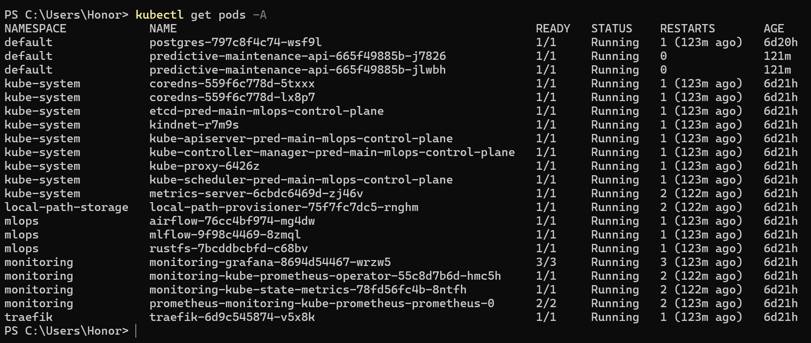

Все показанные pod находятся в Running, контейнеры готовы. Видны две реплики API, PostgreSQL, Airflow, MLflow, RustFS, Prometheus, Grafana, Traefik и системные компоненты. Колонка AGE показывает возраст pod, а не длительность полного запуска по Quickstart.

### 3.2. Метрики и дашборд

[API](src/app/service/app.py) экспортирует HTTP-метрики через `prometheus-fastapi-instrumentator`. Бакеты задержки: 5, 10, 25, 50, 100, 250, 500 и 1000 мс. Границы 25/50/100 мс выбраны вокруг наблюдаемого диапазона: в обычном прогоне Locust p50 составил 31 мс, p95 — 49 мс.

Свои метрики: `predictive_maintenance_model_info{version}`, `predictive_maintenance_predictions_total{machine_failure}`, гистограмма `predictive_maintenance_score`. Уникальные идентификаторы запросов и значения признаков в метки не добавляются.

[ServiceMonitor](k8s/monitoring/servicemonitor.yaml) опрашивает API каждые 15 секунд через именованный порт Service `http`. [Dashboard ConfigMap](k8s/monitoring/dashboard.yaml) имеет метку `grafana_dashboard: "1"`. [Locust](load/locustfile.py) отправляет случайные строки признаков датасета через Ingress; target и признаки причин отказа в запрос не входят. В [Deployment](k8s/deployment.yaml) задан `preStop: sleep 5`; изменение внесено [коммитом bf4d1fd](https://github.com/vladgulchenko/predictive-maintenance-mlops/commit/bf4d1fd).

| Показатель обычного прогона | Значение на снимке |
| --- | --- |
| Запросы / ошибки | 4033 / 0 |
| Пользователи / текущий RPS | 5 / 4,9 |
| p50 / p95 / p99 | 31 / 49 / 64 мс |
| Средняя задержка | 32,77 мс |
| Модель | `predictive-maintenance:v2@champion` |

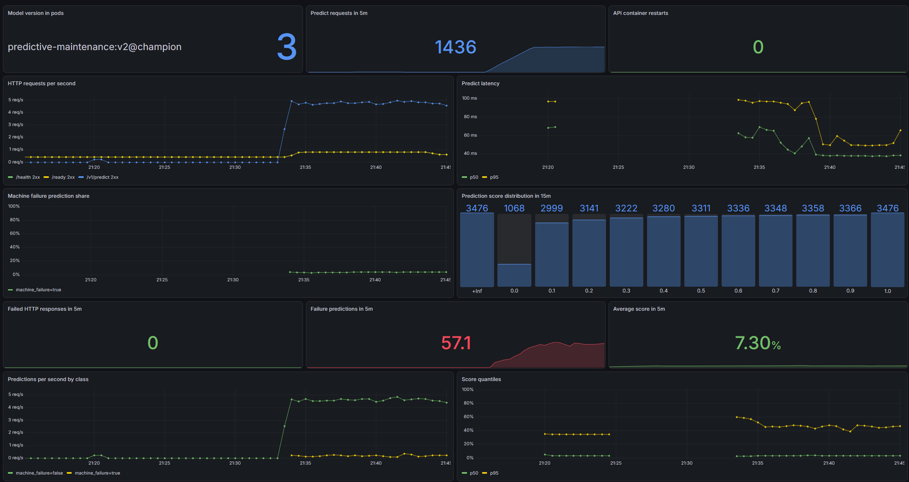

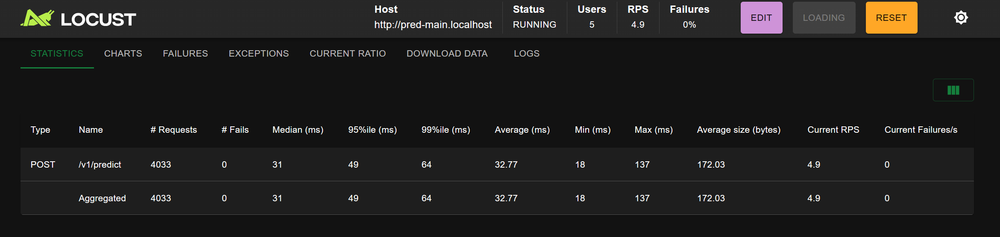

Locust показывает накопленную статистику на момент снимка, а панели Grafana используют временные окна: их счетчики и квантили не обязаны совпадать. Средний score и доля положительных предсказаний не являются точностью модели. Панель `Prediction score distribution in 15m` пока показывает накопительные бакеты, а не частоты отдельных интервалов.

### 3.3. Данные в DVC и S3

В [.dvc/config](.dvc/config) два remote на один бакет: `laptop` обращается к `http://s3.localhost` через Ingress, `cluster` — к `http://rustfs.mlops:9000` внутри Kubernetes. Локальные ключи находятся в игнорируемом `.dvc/config.local`; task pod получают их из Secret `s3-credentials`.

| Версия данных | MD5 | Размер |
| --- | --- | --- |
| Рабочая | `5d9ee05b71518e3e7e71e6e60c7da425` | 567521 байт |
| С неверной температурой | `ca52c8f7e1e7ab3359addc684be2c74c` | 668695 байт |

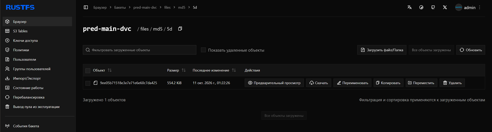

На снимке объект `files/md5/5d/9ee05b71518e3e7e71e6e60c7da425` имеет размер 554,2 KiB, что соответствует 567521 байту с округлением. Хеш и размер совпадают с [DVC-указателем](data/raw/ai4i2020.csv.dvc).

[Dockerfile](Dockerfile) копирует конфигурацию DVC и указатель без CSV, задает `core.no_scm=true` для работы без Git внутри образа. [.dockerignore](.dockerignore) исключает данные, кеш, временные файлы и локальные credentials DVC. Перед validate и train выполняется `dvc pull -r cluster`, затем MD5 прочитанного файла записывается в MLflow.

Содержимое работающего API-контейнера проверено командой:

```powershell
kubectl exec predictive-maintenance-api-7cdbbcb89-f8r9s -- ls data/raw
```

Результат: `ai4i2020.csv.dvc`, без CSV.

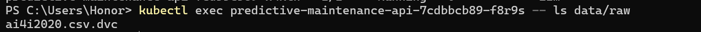

Проверка относится к работающему контейнеру; отдельный запуск образа через `docker run` не сохранен. История двух версий данных и соответствующих `data_md5` находится в [отчете ДЗ3](reports/hw3/REPORT.md#25-dvc-data-versions); те прогоны использовали прежнее локальное хранилище, не S3 кластера.

### 3.4. Проверка данных Pandera

[src/app/validate.py](src/app/validate.py) запускается командой `uv run python -m app.validate`. Он не исправляет данные: при нарушении записывает `failure_cases.csv` в MLflow, оставляет тег `valid=false` и завершает процесс через `SystemExit(1)`. При успехе выставляет `valid=true`.

| Схема | Правила | Выбор границ |
| --- | --- | --- |
| Строки | Типы, обязательные значения, уникальность UDI; Type из L/M/H; бинарные target и признаки причин отказа; диапазоны пяти датчиков | Запас относительно минимума/максимума датасета с учетом единиц измерения |
| Выгрузка | Не менее 1000 строк; доля отказов от 1% до 10% | Рабочая выгрузка содержит 9981 строку и 3,386% отказов |

Числовые границы: температура воздуха 290–310 K, процесса 300–325 K, обороты 1000–3500, момент больше 0 и не больше 100 Н·м, износ 0–300 минут. Схемы вызываются с `lazy=True`: собираются нарушения упавшего этапа.

[Тесты](tests/test_validate.py) создают синтетические данные без CSV: хорошие строки проходят, неверные значения ловятся, маленькая выгрузка и неправильная доля класса отвергаются. Проверяются также теги, артефакт и код выхода модуля.

**CI:** [зеленая tests job](https://github.com/vladgulchenko/predictive-maintenance-mlops/actions/runs/38957337197/job/117163397508), [скрин pytest](reports/hw4/pytest_step.png), [коммит реализации 4c82e58](https://github.com/vladgulchenko/predictive-maintenance-mlops/commit/4c82e58).

Для отдельной локальной проверки использована временная копия CSV с одной температурой 26,85 под заголовком Кельвинов. Исходный датасет не менялся. MLflow run `eb2f4122fb604132abb42f828940f72d`: FAILED, `valid=false`, 9981 строка, одно нарушение.

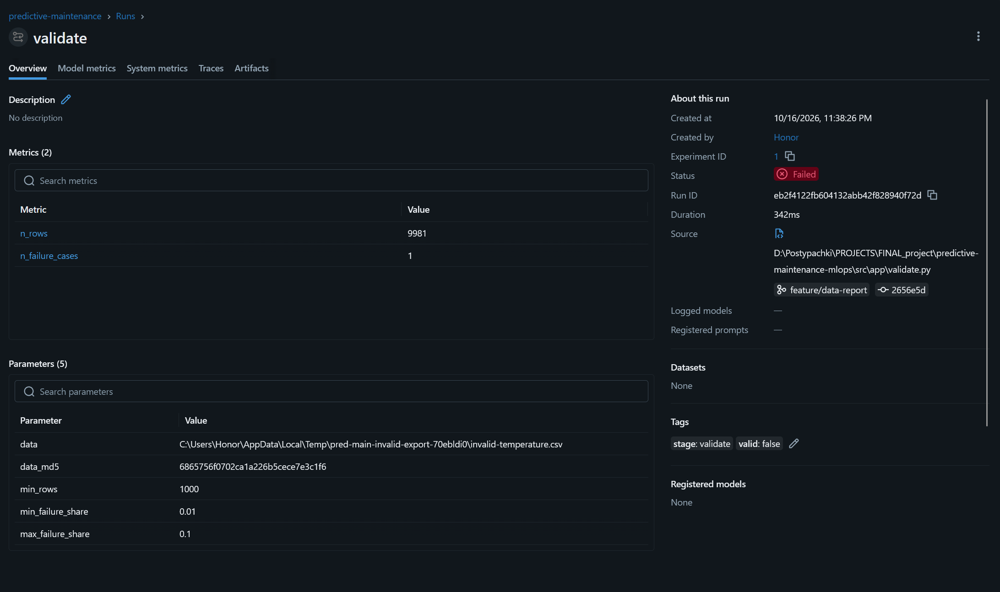

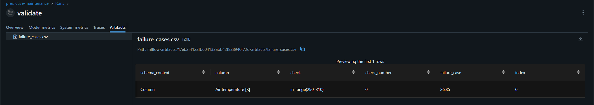

Полный эксперимент с плохой версией в DVC, deploy и остановкой Airflow описан отдельно ниже.

### 3.5. Конвейер переобучения в Airflow

[DAG pred_main_retrain](dags/pred_main_retrain.py): `validate → train → promoted → rollout`. Validate и train работают в отдельных pod из SHA-образа приложения; перед каждым модулем выполняется `dvc pull -r cluster`. Результат обучения передается через XCom. `promoted` использует short_circuit; `rollout` меняет аннотацию шаблона Deployment API.

Расписание — `CronTriggerTimetable("0 3 * * *", timezone="Europe/Minsk")`, без start_date, с `catchup=False` и `max_active_runs=1`. Все приведенные эксперименты запущены вручную. Успех задачи rollout означает запрос рестарта, а не ожидание готовности всех новых pod; смена модели дополнительно видна в Grafana.

Первые три сценария относятся к экспериментам 17–18 октября 2026 года. Контрольный повтор 25 октября приведен отдельно. После пересоздания Registry те же номера могут обозначать другие модели.

#### Сценарий 1. Новая версия лучше

| Показатель | Предыдущий champion v2 | Кандидат v3 |
| --- | --- | --- |
| Число деревьев / минимум объектов в листе | 300 / 2 | 300 / 1 |
| Максимальная глубина / seed | Без ограничения / 42 | Без ограничения / 42 |
| PR-AUC | 0,7870816 | 0,8081883 |

Данные одинаковые: MD5 `5d9ee05b71518e3e7e71e6e60c7da425`. Гейт требует `candidate_pr_auc > champion_pr_auc + 0.005`; прирост около 0,02111 позволил продвижение без ослабления порога.

DAG run: `manual__2026-10-17T20:21:24.768589+00:00`, длительность 36,520 с. MLflow training run: `rare-lark-659`, ID `a6e84ea35e8d4b7d866639517a8dba20`; validate run: `5b30c4f969ee4ea1a52f5cb98f1916a7`.

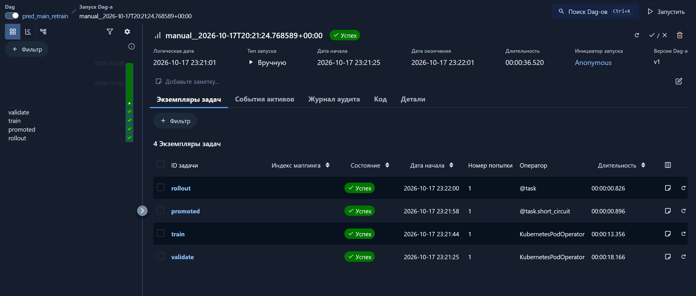

[Параметры и метрики кандидата v3](reports/hw4/new_champion@v3.png) · [успешный validate с хорошим MD5](reports/hw4/validate.png).

Во время обучения и выката Locust продолжал отправлять запросы через Ingress:

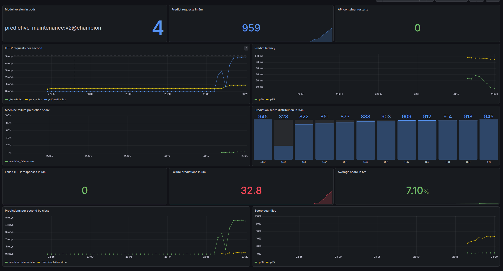

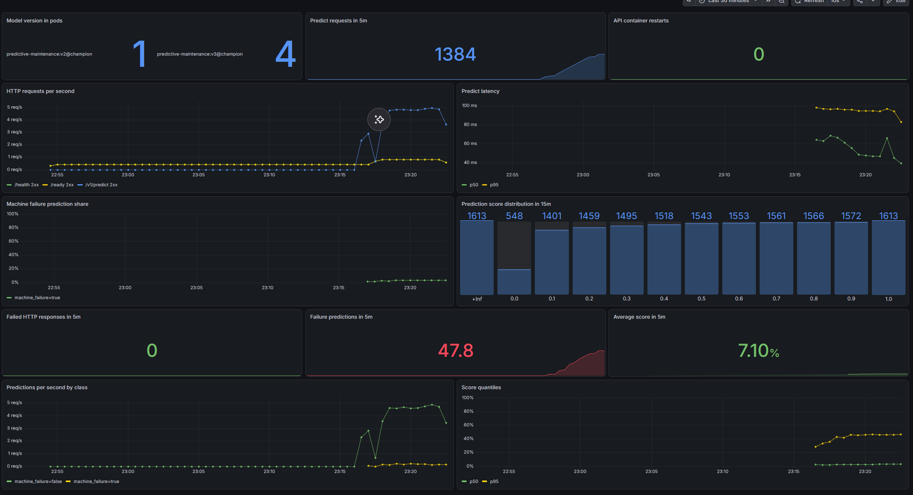

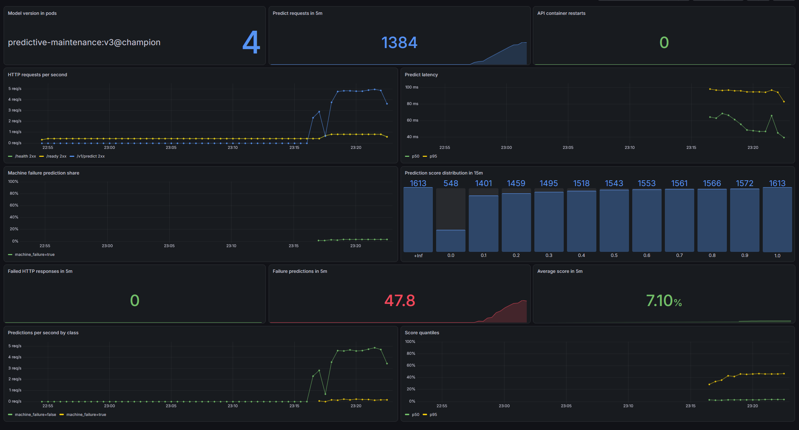

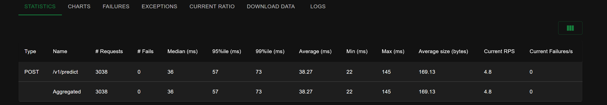

На момент снимка Locust: 3038 запросов, 0 ошибок, RPS 4,8, p50/p95/p99 — 36/57/73 мс. Точное время начала и завершения теста на снимке не видно. Числа рядом с версиями Grafana — количество наблюдаемых временных рядов, не номера моделей; `RESTARTS=0` не исключает замену pod при rollout.

#### Сценарий 2. Гейт не пустил

Кандидат v4 обучен на тех же данных: 200 деревьев, минимум 3 объекта в листе, глубина без ограничения, seed 42. PR-AUC 0,7470950 ниже требуемых 0,8131883 для champion v3.

DAG run: `manual__2026-10-17T21:01:32.583781+00:00`, длительность 23,276 с. Training run: `bouncy-cod-285`.

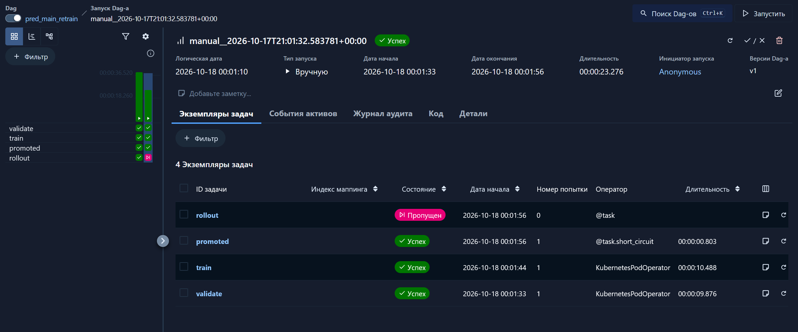

[Параметры и метрики v4](reports/hw4/model@v4.png) · [регистрация кандидата](reports/hw4/model_registry_not_promoted.png).

`promoted` зеленый, потому что успешно прочитал результат сравнения и вернул false. У rollout 0 попыток: тело задачи не выполнялось. Это штатный отказ гейта, не ошибка обучения.

#### Сценарий 3. Плохая выгрузка и восстановление

В CSV температура воздуха переведена из Кельвинов в Цельсии вычитанием 273,15 без изменения заголовка. Файл читался, содержал 9981 строку и прежние типы; нарушился смысл значений. После `dvc add` и `dvc push` новый указатель закоммичен и доставлен новым SHA-образом.

- [Поломка 9975dfb](https://github.com/vladgulchenko/predictive-maintenance-mlops/commit/9975dfb6d87991a1eda9fc128f68ded230bdbe9e), [PR #30](https://github.com/vladgulchenko/predictive-maintenance-mlops/pull/30), [deploy 39075314111](https://github.com/vladgulchenko/predictive-maintenance-mlops/actions/runs/39075314111).
- [Revert 89948bf](https://github.com/vladgulchenko/predictive-maintenance-mlops/commit/89948bfafe31065c12f79ebe744201dbab1c9e4e), [PR #31](https://github.com/vladgulchenko/predictive-maintenance-mlops/pull/31), [deploy восстановления 39076815188](https://github.com/vladgulchenko/predictive-maintenance-mlops/actions/runs/39076815188).

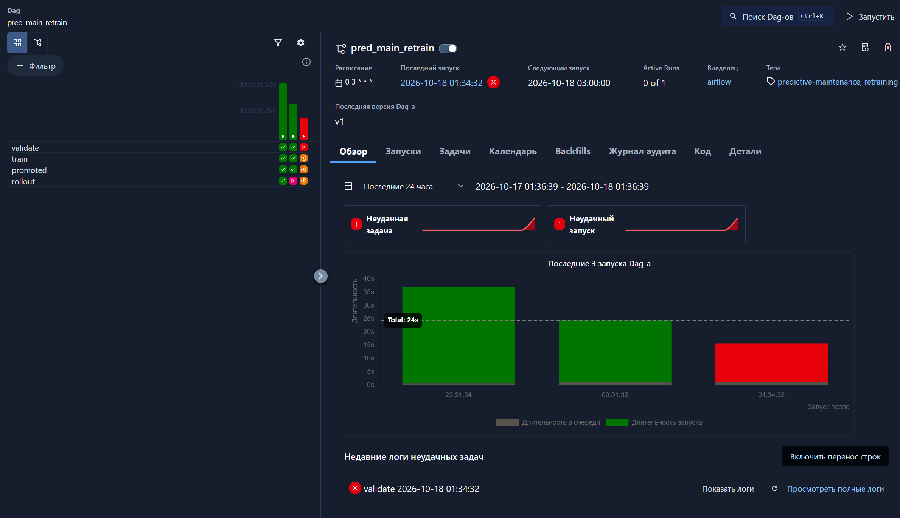

MLflow run `003551de68234db0a8dcbe560917241b`: FAILED, `valid=false`, плохой MD5 `ca52c8f7e1e7ab3359addc684be2c74c`, 9981 строка и 9981 нарушение. Ошибка относится к диапазону температуры, не к скачиванию S3.

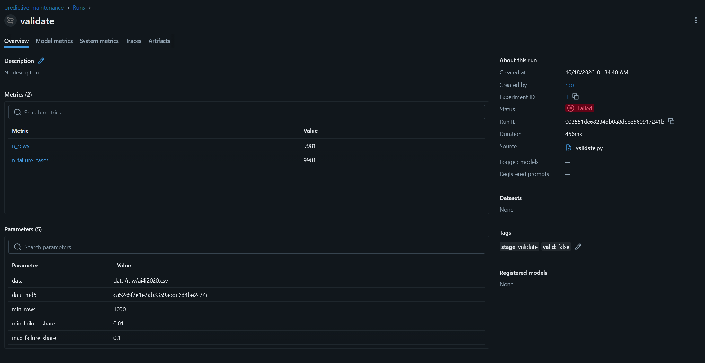

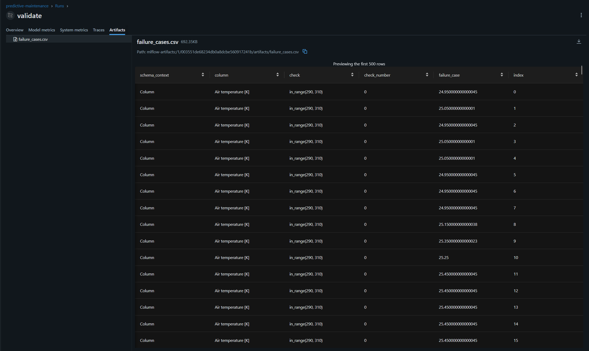

После revert хороший указатель восстановлен; `dvc checkout` вернул рабочий CSV. MD5 совпал с `5d9ee05b71518e3e7e71e6e60c7da425`. После повторного deploy DAG снова успешно выполнил validate и train; rollout пропущен, поскольку нового улучшения нет.

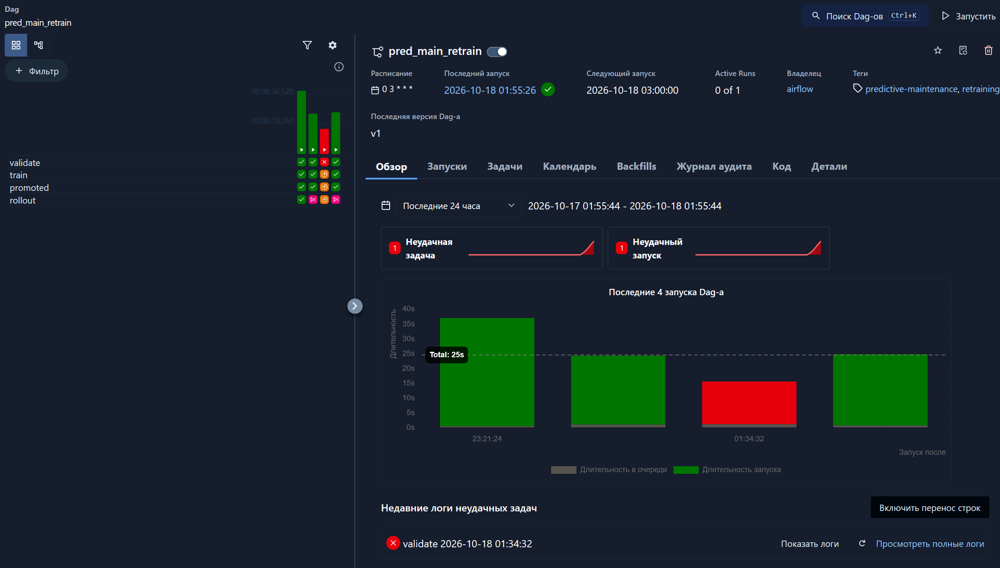

На снимках время запусков в UI: 01:34:32 для плохой выгрузки и 01:55:26 после восстановления. Ответы API за этот исторический интервал не сохранены; работа прежней модели при плохих данных проверена отдельным повтором 25 октября.

#### Проверка после повторного развертывания

После создания нового кластера в Registry зарегистрированы версии v1 и v2. У v2 назначены оба alias: `challenger` и `champion`. Последний кандидат может иметь оба назначения, если он прошел гейт.

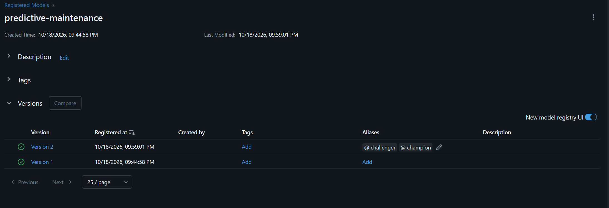

На графе запуска `manual__2026-10-18T18:58:33.767779+00:00` все четыре задачи завершились успешно.

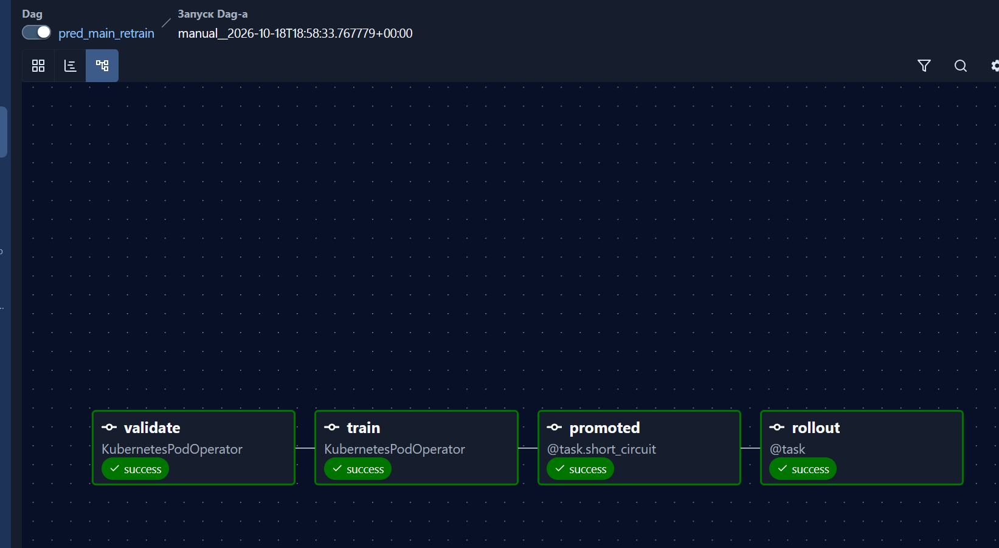

Эти снимки относятся к повторному развертыванию. Метрики и статусы прежних сценариев с v3/v4 приведены выше; номера версий между двумя реестрами не сопоставляются.

#### Контрольный повтор 25 октября: API при плохой выгрузке

Повторно доставлен указатель на CSV с температурой воздуха в Цельсиях под прежним заголовком Кельвинов. [Коммит 6334848](https://github.com/vladgulchenko/predictive-maintenance-mlops/commit/63348481e8cb70c837d65b2b01af7d1da7dc2878) меняет только DVC-указатель: хороший MD5 `5d9ee05b71518e3e7e71e6e60c7da425` заменен на `ca52c8f7e1e7ab3359addc684be2c74c`. [PR #36](https://github.com/vladgulchenko/predictive-maintenance-mlops/pull/36) слит в main; [deploy плохой выгрузки](https://github.com/vladgulchenko/predictive-maintenance-mlops/actions/runs/40218178742/job/121244070489) завершился успешно.

Во всех трех запросах через Swagger использован один payload `good.json`: Type M, температуры 298,1/308,6 K, 1551 об/мин, момент 42,8 Н·м, износ 0. Ответы содержат `model_version=predictive-maintenance:v2@champion`, `score=0` и `machine_failure=false`.

| Этап | Время 25.10.2026, UTC | Результат и доказательство |
| --- | --- | --- |
| До изменения данных | 16:09:12 | [Predict HTTP 200, модель v2](reports/hw4/data-recheck/responce-before.png) |
| Доставлен плохой указатель | Deploy завершен в 17:51:44 | [Tests, build и deploy успешны](https://github.com/vladgulchenko/predictive-maintenance-mlops/actions/runs/40218178742) |
| Запущен DAG на плохих данных | Run ID содержит 17:53:37 | [Validate failed, train/promoted/rollout upstream_failed](reports/hw4/data-recheck/dag-before.png) |
| После отказа validate, до восстановления | 17:55:26 | [Predict HTTP 200, прежняя модель v2](reports/hw4/data-recheck/responce_after_validate.png) |
| Доставлен хороший указатель | Deploy завершен в 18:10:21 | [Deploy восстановления успешен](https://github.com/vladgulchenko/predictive-maintenance-mlops/actions/runs/40219793665/job/121248940474) |
| DAG после восстановления | Run ID содержит 18:19:49 | [Validate/train/promoted success, rollout skipped](reports/hw4/data-recheck/dag-after.png) |
| Ответ API после восстановления | 18:21:52 | [Predict HTTP 200, модель v2](reports/hw4/data-recheck/responce-after.png) |

Время ответов взято из HTTP-заголовка `Date` (GMT), время deploy — из GitHub Actions. Полные Run ID Airflow:

- Плохая выгрузка: `manual__2026-10-25T17:53:37.199913+00:00`, статус FAILED, длительность 14,951 с.
- После восстановления: `manual__2026-10-25T18:19:49.611321+00:00`, статус SUCCESS, длительность 23,425 с.

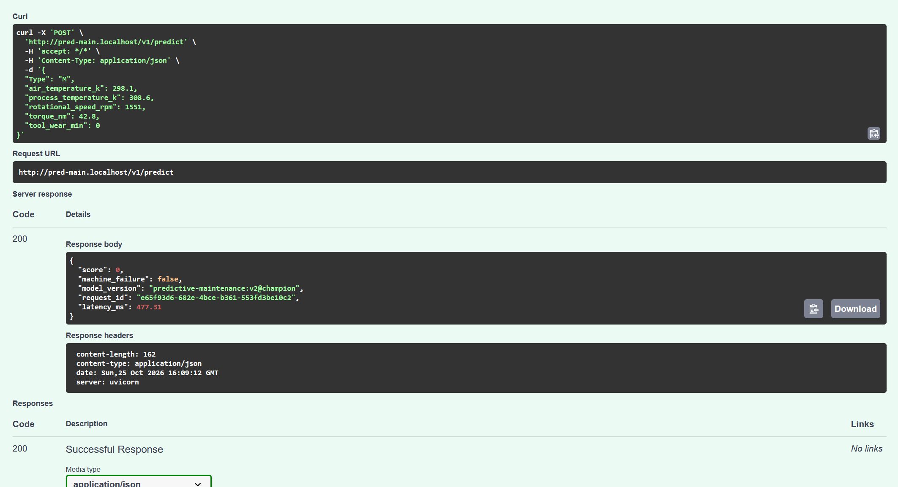

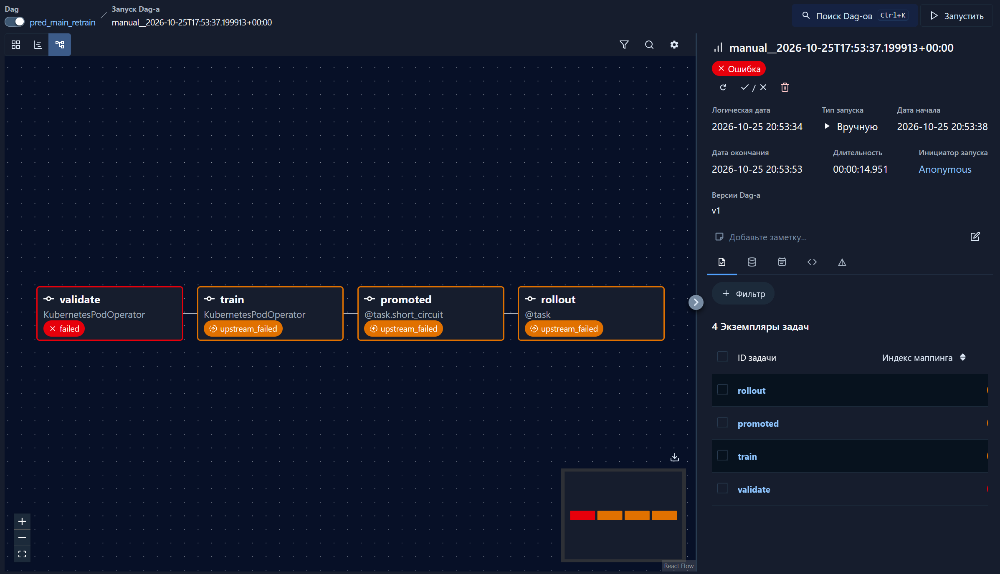

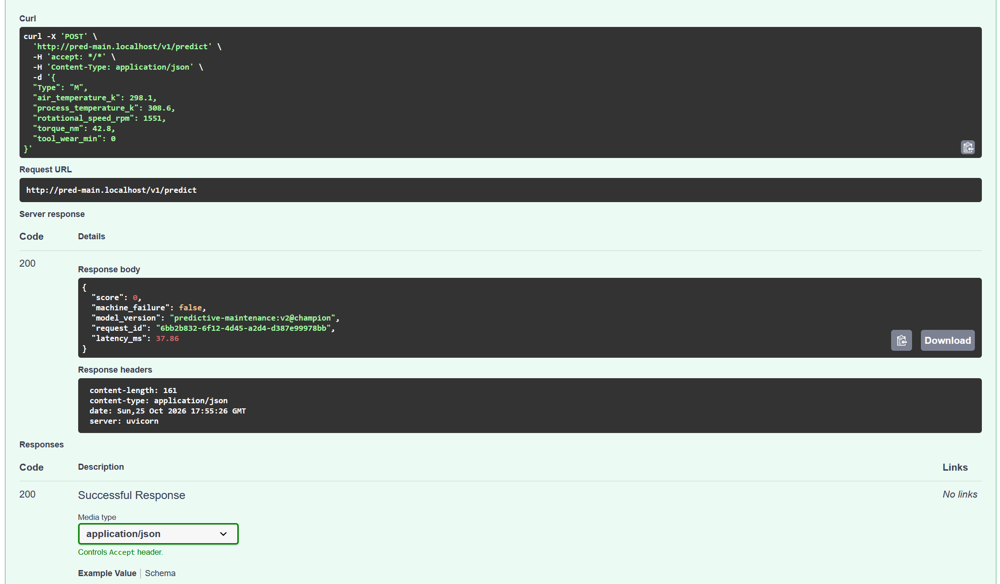

Для восстановления [коммит 7014247](https://github.com/vladgulchenko/predictive-maintenance-mlops/commit/70142471fe493505e5232f32f49663c5dd02a310) отменил изменение указателя; [PR #37](https://github.com/vladgulchenko/predictive-maintenance-mlops/pull/37) слит в main. После `dvc checkout` и [повторного deploy](https://github.com/vladgulchenko/predictive-maintenance-mlops/actions/runs/40219793665) проверка данных и обучение снова прошли. Rollout пропущен: кандидат не получил достаточного улучшения для продвижения.

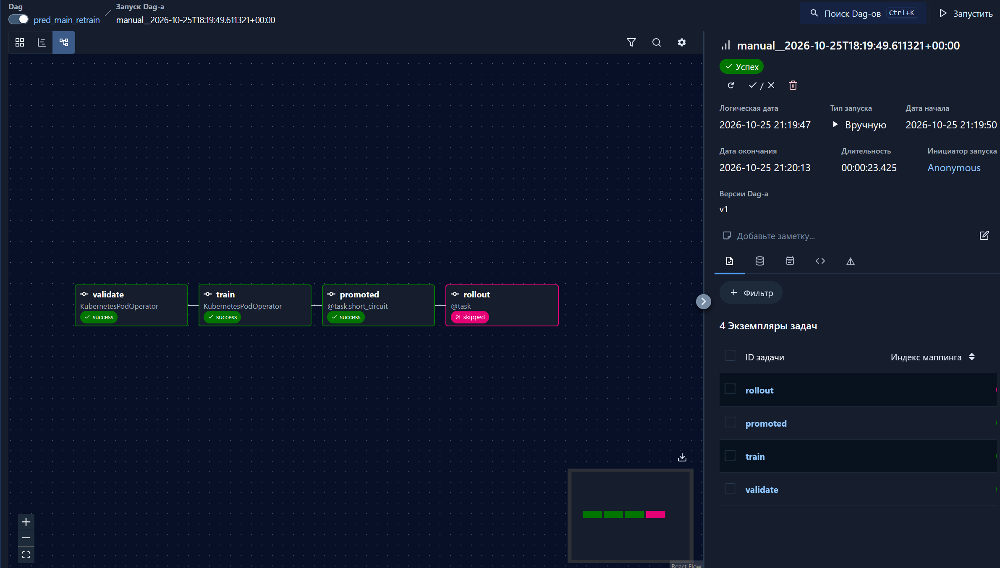

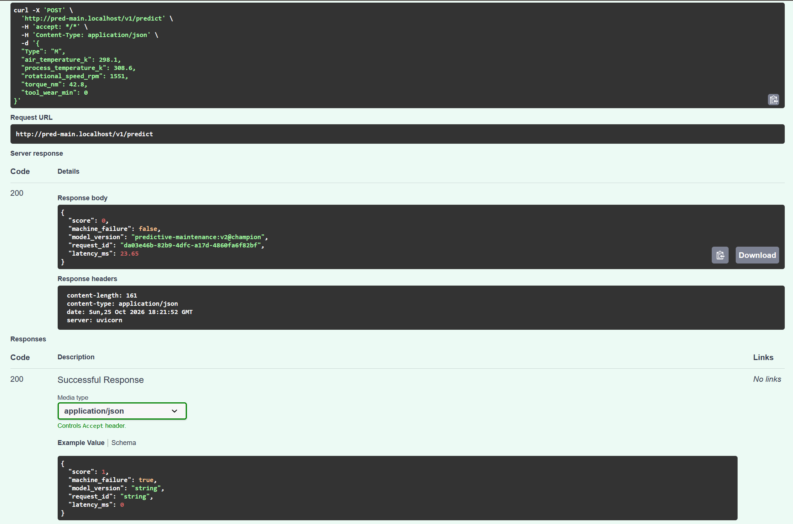

После отказа validate API ответил прежней моделью до deploy восстановления. Это подтверждает работоспособность predict в момент проверки; непрерывная доступность за весь интервал не измерялась. Отдельные ответы `/health` в этом повторе не сохранены.

### 3.6. CI/CD целиком

[Workflow](.github/workflows/ci.yaml) выполняет tests, build и ручной deploy на main. Deploy работает на self-hosted runner с меткой kind, загружает SHA-образ в кластер, применяет Secret через `--dry-run=client -o yaml | kubectl apply`, затем PostgreSQL и API.

Шаг `monitoring and DAG` обновляет ServiceMonitor, dashboard ConfigMap, ConfigMap с DAG и Airflow Variable `pred_main_image`. Он не запускает переобучение. Платформа устанавливается отдельно через up.sh, без повторного Helm upgrade при каждом deploy приложения.

**Подтверждение:** [прогон 39156310968](https://github.com/vladgulchenko/predictive-maintenance-mlops/actions/runs/39156310968), [tests](https://github.com/vladgulchenko/predictive-maintenance-mlops/actions/runs/39156310968/job/117760146341), [build](https://github.com/vladgulchenko/predictive-maintenance-mlops/actions/runs/39156310968/job/117760296279), [deploy](https://github.com/vladgulchenko/predictive-maintenance-mlops/actions/runs/39156310968/job/117760378407). Все job и шаг smoke успешны.

Текущий smoke проверяет health/ready через Ingress, формат Registry-версии, диапазон score, наличие имени метрики, ServiceMonitor, dashboard, ответ Grafana и ровно одну запись PostgreSQL по request_id. Проверка ожидаемого класса и метки version пока отсутствует.

## 4. Прогоны и коммиты

| Что доставлено | Зеленый прогон | Коммит main |
| --- | --- | --- |
| DAG с параметрами перед экспериментами v3/v4 | [39061690529](https://github.com/vladgulchenko/predictive-maintenance-mlops/actions/runs/39061690529) | [37748f8](https://github.com/vladgulchenko/predictive-maintenance-mlops/commit/37748f8201d56b0ad19e8d78045a2b0a82dd8316), merge [6aa01d0](https://github.com/vladgulchenko/predictive-maintenance-mlops/commit/6aa01d0) |
| Плохой указатель данных | [39075314111](https://github.com/vladgulchenko/predictive-maintenance-mlops/actions/runs/39075314111) | [969573b](https://github.com/vladgulchenko/predictive-maintenance-mlops/commit/969573b67eb2cfec442fa1fa6b36eb2326827452), merge 9975dfb |
| Восстановленный указатель | [39076815188](https://github.com/vladgulchenko/predictive-maintenance-mlops/actions/runs/39076815188) | [ea6f0e4](https://github.com/vladgulchenko/predictive-maintenance-mlops/commit/ea6f0e43ff7369e65c27f9e5055996eea6342d7c), merge revert 89948bf |
| Deploy после подготовки нового кластера | [39156310968](https://github.com/vladgulchenko/predictive-maintenance-mlops/actions/runs/39156310968) | [d890aa9](https://github.com/vladgulchenko/predictive-maintenance-mlops/commit/d890aa93c8f73331b1ee24c05c0415c6f72be16a) |
| Контрольный повтор: плохой указатель 25 октября | [40218178742](https://github.com/vladgulchenko/predictive-maintenance-mlops/actions/runs/40218178742) | [b15cc47](https://github.com/vladgulchenko/predictive-maintenance-mlops/commit/b15cc47efc23d660855cbf220aaa9a514e641d80), merge [6334848](https://github.com/vladgulchenko/predictive-maintenance-mlops/commit/63348481e8cb70c837d65b2b01af7d1da7dc2878) |
| Контрольный повтор: восстановление 25 октября | [40219793665](https://github.com/vladgulchenko/predictive-maintenance-mlops/actions/runs/40219793665) | [84f2f8f](https://github.com/vladgulchenko/predictive-maintenance-mlops/commit/84f2f8f2ce1a617d916763894eec72521786f360), merge revert [7014247](https://github.com/vladgulchenko/predictive-maintenance-mlops/commit/70142471fe493505e5232f32f49663c5dd02a310) |

Во всех шести прогонах tests, build и deploy завершились успешно. Это прогоны доставки, не запуски DAG. Зеленый deploy плохого указателя ожидаем: проверка семантики CSV выполняется позже в задаче validate.

## 5. Журнал проблем

| Проблема / ошибка | Причина | Решение и подтверждение |
| --- | --- | --- |
| Python/MLflow/DVC: `getaddrinfo failed` для *.localhost | Системный DNS не разрешал локальные имена | В Quickstart добавлена настройка hosts; чистый запуск после настройки выполнен |
| `dvc status`: `There are no data or pipelines tracked in this project yet` | Правила ignore скрывали каталог data при обходе DVC | [a1bd2eb](https://github.com/vladgulchenko/predictive-maintenance-mlops/commit/a1bd2eb) убрал перекрывающие правила; CSV остался исключен через data/raw/.gitignore |
| Повторная установка monitoring при deploy API | Подготовка платформы смешивалась с доставкой приложения | [787982a](https://github.com/vladgulchenko/predictive-maintenance-mlops/commit/787982a): в deploy остались monitoring-ресурсы и DAG; установка платформы выполняется up.sh |
| Пустые панели предсказаний | В окне наблюдения были probes, но не запросы predict | Запущен Locust через Ingress; заполнение видно на скрине Grafana |
| Pandera: `in_range(290, 310)` для температуры около 25 | CSV сохранил типы, но температура пришла в Цельсиях | Validate остановил обучение и сохранил артефакт; revert 89948bf и повторный deploy восстановили конвейер |

## 6. Переделки

### ДЗ1: Kubernetes, отчет и команды проверки

Исправления внесены после первоначальной сдачи ДЗ1.

| Пункт фидбека | Что сделано | Коммит и подтверждение |
| --- | --- | --- |
| Не было Kubernetes-манифестов и команды запуска в kind | Добавлены Deployment с двумя репликами API и Service, затем ConfigMap и PostgreSQL. В README описаны загрузка образа в kind, применение манифестов, rollout и port-forward; текущий Quickstart использует автоматизированный deploy через runner. | [a7eda69: Deployment и Service](https://github.com/vladgulchenko/predictive-maintenance-mlops/commit/a7eda69), [a024b4c: PostgreSQL и ConfigMap](https://github.com/vladgulchenko/predictive-maintenance-mlops/commit/a024b4c), [433f30f: команды kind](https://github.com/vladgulchenko/predictive-maintenance-mlops/commit/433f30f). Проверки: [две реплики API в k9s](reports/hw1/k9s_with_2pods.jpg), [текущие pod платформы](reports/hw4/get-pods.png). |
| В отчете оставались TODO вместо скриншотов | Убраны заглушки. Отчет содержит результаты pytest и запросов к PostgreSQL, снимки pod и логов API, команду и ответ predict через port-forward. | [433f30f: оформление скриншотов](https://github.com/vladgulchenko/predictive-maintenance-mlops/commit/433f30f), [832de74: исправления после ревью](https://github.com/vladgulchenko/predictive-maintenance-mlops/commit/832de74). [Отчет ДЗ1](reports/hw1/REPORT.md), [pytest](reports/hw1/pytest.jpg), [PostgreSQL](reports/hw1/database_select.jpg), [логи API](reports/hw1/post-log_in_k9s.jpg), [predict](reports/hw1/predict_from_port-forward.jpg). |
| В README не было трех команд проверки сервиса | В Quickstart приведены запросы к health, ready и predict с good.json через Ingress, ожидаемые ответы и порядок запуска платформы из клона репозитория. | [6a68471: добавлены команды проверки](https://github.com/vladgulchenko/predictive-maintenance-mlops/commit/6a68471), [текущий раздел README](README.md#7-развернуть-api). Проверки health/ready/predict также выполняет [успешный deploy 39156310968](https://github.com/vladgulchenko/predictive-maintenance-mlops/actions/runs/39156310968/job/117760378407). |

### ДЗ4: ответ прежней моделью при плохих данных

| Пункт фидбека | Что сделано | Коммит и подтверждение |
| --- | --- | --- |
| Не был сохранен ответ API прежней моделью при плохой выгрузке | 25 октября повторены доставка плохого указателя, отказ validate и восстановление. Predict после красного validate вернул HTTP 200 с той же версией v2, что до поломки; запрос выполнен до deploy восстановления. | [Поломка 6334848](https://github.com/vladgulchenko/predictive-maintenance-mlops/commit/63348481e8cb70c837d65b2b01af7d1da7dc2878), [revert 7014247](https://github.com/vladgulchenko/predictive-maintenance-mlops/commit/70142471fe493505e5232f32f49663c5dd02a310), [цепочка доказательств](#контрольный-повтор-25-октября-api-при-плохой-выгрузке). |

## 7. Что не закрыто

### Технические замечания из фидбека

- **НЕ ИСПРАВЛЕНО:** smoke проверяет диапазон score, а не `machine_failure=false` для good.json; поиск имени метрики может совпасть с HELP и не проверяет `version=`.
- **НЕ ИСПРАВЛЕНО:** панель score показывает накопительные бакеты; формат heatmap пока не задан.
- **НЕ ИСПРАВЛЕНО:** подготовка CSV в Quickstart использует платформенный перевод строк; для воспроизведения указанного MD5 на Linux/macOS требуется явный CRLF.

## 8. Восемь вопросов

### 8.1. Как восстановить код и данные модели версии N?

По версии N в Registry нахожу run_id, затем data_md5, гиперпараметры и тег mlflow.source.git.commit, если он записан. Выбираю соответствующий коммит в отдельном клоне, устанавливаю зависимости по uv.lock и получаю датасет через DVC-указатель этого коммита, сверяя MD5 с прогоном. Для обучения из pod SHA явно не логируется: без сохраненной связи run с SHA-образом точный код только по номеру модели восстановить нельзя; текущая Variable pred_main_image не заменяет историческую запись.

### 8.2. Почему данные не в образе и что будет при git push раньше dvc push?

Образ содержит указатель, а CSV хранится в S3: это не раздувает образ и позволяет получить конкретную версию по хешу. Сначала загружается объект через dvc push, затем публикуется указатель через Git. Иначе CI может успешно доставить образ, но dvc pull в задаче validate упадет из-за отсутствующего объекта; ошибка будет в логах task pod, до запуска Pandera.

### 8.3. Какие проверки бинарные, какие пороговые и как выбраны границы?

Типы, обязательные поля, категории L/M/H и уникальность UDI проверяются без настройки числового порога. Диапазоны датчиков выбраны с запасом относительно данных и с учетом единиц; для 9981 строки и 3,386% отказов установлены минимум 1000 строк и коридор доли класса 1–10%. Слишком строгие границы будут блокировать допустимые выгрузки; причины отказов нужно анализировать, а не автоматически ослаблять схему.

### 8.4. Чем Pandera отличается от Pydantic и зачем нужны обе?

Pandera проверяет таблицу перед обучением: значения строк, уникальность, объем и распределение target. Pydantic проверяет отдельный JSON-запрос API и отклоняет неверные признаки до предсказания. Корректная строка запроса не гарантирует качества всей выгрузки, а проверка обучающих данных не защищает API от неверного запроса.

### 8.5. Почему обучение в отдельном pod и почему новая модель не требует пересборки образа?

Отдельный pod изолирует ресурсы, зависимости и сбои обучения от процессов Airflow. Используется тот же SHA-образ приложения, данные скачиваются через DVC, а обученная модель сохраняется отдельно в MLflow. После продвижения достаточно обновить champion и перезапустить API; если меняются код, зависимости или DVC-указатель в образе, пересборка уже нужна.

### 8.6. Какие метрики про инфраструктуру, сервис и модель? Почему не request_id?

Инфраструктуру отражают перезапуски API-контейнеров; сервис — RPS, HTTP-ошибки и p50/p95 задержки. Модель — загруженная версия, доля положительных предсказаний и средний score; без истинных меток это не онлайн-точность. Request_id создает уникальный временной ряд на каждый запрос и увеличивает кардинальность, поэтому он хранится в PostgreSQL, не в метках Prometheus.

### 8.7. Что происходит при выкате, зачем preStop и что было без него?

DAG инициирует rolling restart, новые API-pod загружают champion и принимают трафик после readiness. Пауза preStop дает маршрутизации время учесть завершение старого pod до остановки приложения, но не гарантирует отсутствие ошибок. В эксперименте зафиксированы переход v2 → v3 и 3038 запросов Locust без ошибок; отдельного сравнительного прогона без preStop нет, поэтому его эффект не измерен.

### 8.8. Какой отказ наиболее вероятен, когда его заметим и что делать первым?

Вероятный отказ — семантически неверная выгрузка, например Цельсии под заголовком Кельвинов. Ее обнаружит ближайший validate: при расписании раз в сутки ожидание может составить почти сутки; автоматическое оповещение в этой конфигурации не настроено. Сначала проверяю valid=false, data_md5 и failure_cases в MLflow, затем возвращаю хороший указатель через Git/DVC, доставляю его и повторяю DAG.
