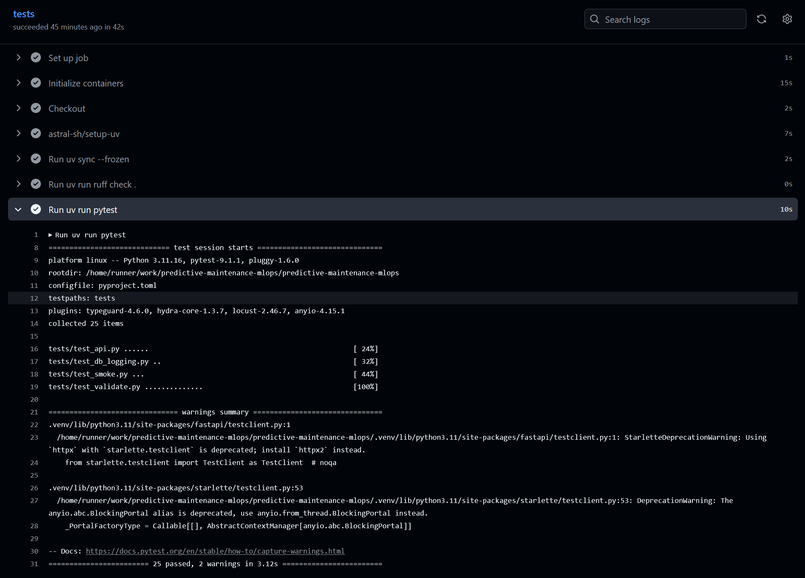
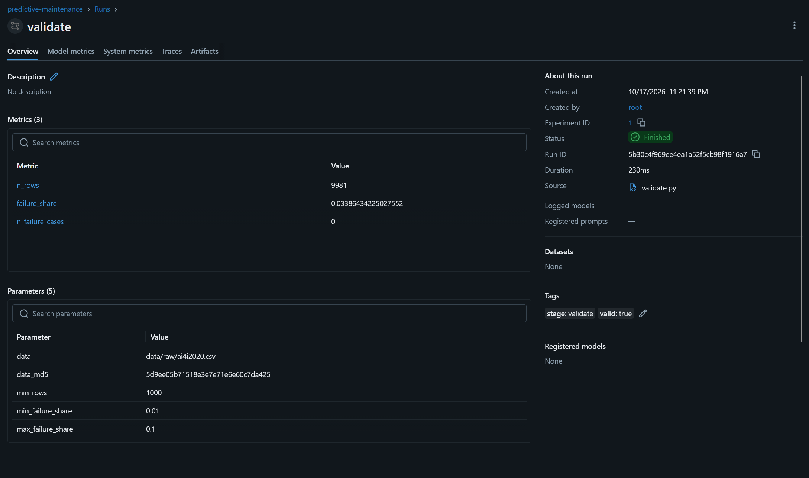
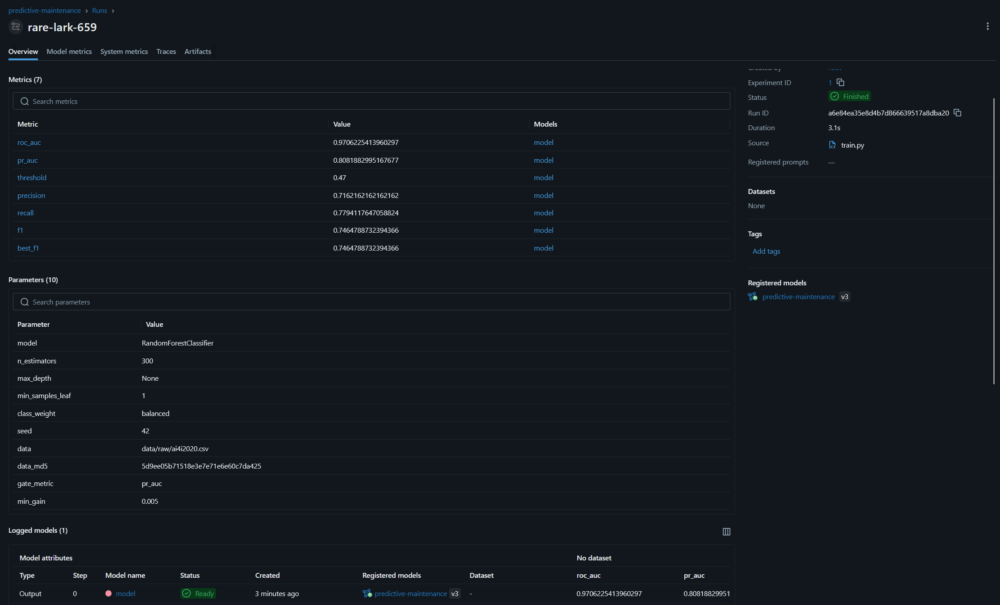
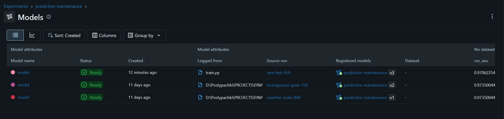
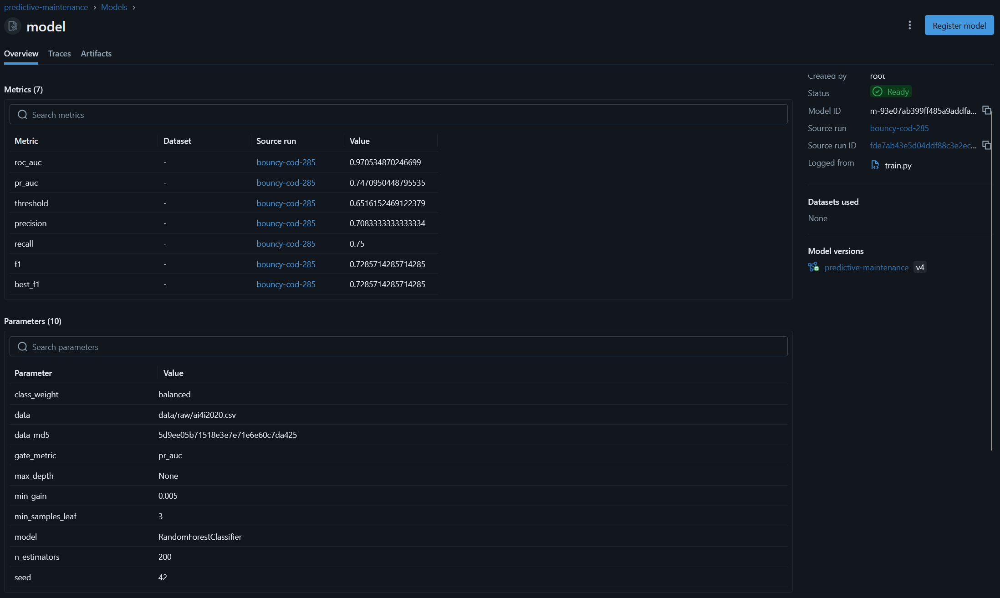
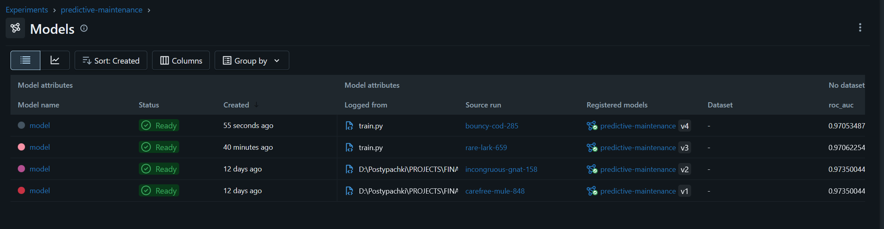

# Домашняя работа 4. Предиктивное обслуживание оборудования

Это рабочий отчет: здесь собраны устройство проекта, результаты проверок и пояснения к решениям. Его можно использовать как справочник для следующих проектов. Изменение в коде, применение в кластере и подтверждение реальным прогоном отмечаются отдельно.

Для финальной сдачи итоговый `REPORT.md` должен находиться в корне репозитория. В README будет Quickstart от клонирования до ответа API через Ingress, адреса интерфейсов и запуск переобучения. Сейчас этот файл служит основой для итогового отчета и будущей инструкции запуска.

## 1. Состояние работы

| Блок | Что сделано | Что еще подтвердить или оформить |
| --- | --- | --- |
| Метрики и Grafana | Метрики API и модели, ServiceMonitor, dashboard ConfigMap; есть скрин под трафиком | Исправить представление накопительных бакетов скоров или переименовать панель |
| Генератор трафика | Обычный прогон и выкат v2 -> v3 под трафиком: на снимке Locust 3038 запросов, 0 ошибок | Скрин не фиксирует точное время начала/остановки Locust |
| Остановка API | В Deployment добавлен `preStop` с паузой 5 секунд; выкат модели под нагрузкой выполнен | Скрины не показывают фактический hook pod; отдельно не сравнивались прогоны с ним и без него |
| DVC и S3 | Два remote на RustFS; validate и train в DAG завершились успешно на ожидаемом MD5 | Буквальная команда `docker run` из ТЗ заменена проверкой через `kubectl exec` |
| Pandera | Синтетические тесты, реальные ошибки в MLflow; плохая выгрузка остановила DAG до обучения | Схемы и тесты в разделе 4, остановка DAG в разделе 5.9 |
| Airflow | Выполнены продвижение, отказ гейта и плохая выгрузка с восстановлением, раздел 5 | Дополнить доказательства: Aliases, неизменность pod при отказе гейта, ответы API при плохих данных, успешный MLflow validate после отката |
| CI/CD | Тесты, SHA-образ, ручной self-hosted deploy, smoke | Добавить ссылку на соответствующий зеленый прогон |
| Запуск с нуля | Манифесты платформы существуют | `up.sh`, `.gitattributes`, полный Quickstart и проверка восстановления |

## 2. Метрики и дашборд

### 2.1. Как идет трафик и собираются метрики

Locust работает на ноутбуке, вне Kubernetes. Он отправляет запросы на `http://pred-main.localhost`, поэтому проверяется путь через Ingress, а не подключение к одному pod через port-forward.

```text
Locust -> Traefik / Ingress -> API-pod -> предсказание и запись в PostgreSQL
                                 |
                                 +-> /metrics <- Prometheus <- ServiceMonitor
                                                    |
                                                 Grafana
```

API обновляет счетчики и гистограммы в памяти процесса. Prometheus самостоятельно опрашивает `/metrics`. Grafana выполняет запросы к Prometheus и отображает результаты; приложение не отправляет метрики напрямую в Grafana.

Метрики отдельны для каждого API-процесса. После перезапуска pod его счетчики начинаются заново. Для анализа их изменения используются `rate()` и `increase()`.

### 2.2. Технические метрики и бакеты

В [приложении](../../src/app/service/app.py) используется `prometheus-fastapi-instrumentator`:

```python
LATENCY_BUCKETS = (0.005, 0.01, 0.025, 0.05, 0.1, 0.25, 0.5, 1)
Instrumentator().instrument(app, latency_lowr_buckets=LATENCY_BUCKETS).expose(app)
```

Экспортируются число HTTP-запросов по обработчикам и статусам, гистограмма задержки и endpoint `/metrics`.

Границы бакетов заданы в секундах: 5, 10, 25, 50, 100, 250, 500 и 1000 мс. В зафиксированном прогоне Locust p50 составил 31 мс, p95 — 49 мс. Границы 25/50/100 мс находятся вокруг рабочего диапазона; верхние границы позволяют наблюдать более медленные ответы.

Клиентские задержки включают сеть и Ingress, поэтому это ориентир для выбора бакетов, а не требование точного совпадения с серверной гистограммой. Квантили Prometheus являются оценками по бакетам: p95 не означает, что каждый запрос занимал ровно это время.

### 2.3. Метрики модели

| Метрика | Тип и метки | Назначение |
| --- | --- | --- |
| `predictive_maintenance_model_info` | Gauge, `version` | Версия, загруженная процессом API; после загрузки значение равно 1 |
| `predictive_maintenance_predictions_total` | Counter, `machine_failure` | Количество положительных и отрицательных предсказаний |
| `predictive_maintenance_score` | Histogram, границы 0.0, 0.1, ..., 1.0 | Наблюдения вероятностей отказа |

В метках нет `request_id`, идентификаторов оборудования и значений признаков: они создавали бы большое количество уникальных временных рядов. Конкретный запрос ищется по `request_id` в PostgreSQL.

Доля положительных предсказаний показывает, как часто модель выдала класс отказа после применения порога. Средний score усредняет вероятности. Ни одна из этих величин без истинных ответов не является точностью модели.

### 2.4. Какие файлы связывают приложение и мониторинг

| Файл | Назначение |
| --- | --- |
| [platform/monitoring-values.yaml](../../platform/monitoring-values.yaml) | Настройки monitoring-чарта для kind, обнаружение ServiceMonitor и dashboard ConfigMap |
| [k8s/service.yaml](../../k8s/service.yaml) | Service API с именованным портом `http` |
| [k8s/monitoring/servicemonitor.yaml](../../k8s/monitoring/servicemonitor.yaml) | Сбор `/metrics` через порт Service `http` каждые 15 секунд |
| [k8s/monitoring/dashboard.yaml](../../k8s/monitoring/dashboard.yaml) | Dashboard ConfigMap с меткой `grafana_dashboard: "1"` |
| [platform/ingress.yaml](../../platform/ingress.yaml) | Маршруты API и Grafana по разным Host |
| [k8s/deployment.yaml](../../k8s/deployment.yaml) | Запуск API, probes, ресурсы и `preStop` |

ServiceMonitor выбирает Service по метке `app: pred-main-api`. Его `port: http` — имя порта Service, а не числовой порт контейнера. Prometheus Operator использует этот объект для настройки сбора метрик.

Sidecar Grafana подхватывает dashboard ConfigMap. Описание панелей хранится в Git и доставляется вместе с ресурсами приложения, а не существует только как ручная настройка интерфейса.

### 2.5. Подготовка платформы и обычный deploy

Prometheus/Grafana устанавливаются отдельно при подготовке платформы. `monitoring-values.yaml` — параметры Helm-чарта, а не готовый манифест для `kubectl apply`. Helm формирует ресурсы из шаблонов и values и сам отправляет запросы Kubernetes API.

В текущем CI установка Helm и повторный upgrade monitoring-чарта при каждом deploy API убраны. Платформа, включая namespace `monitoring`, Prometheus Operator и его CRD, должна быть подготовлена заранее. Эту подготовку предстоит закрепить в `platform/up.sh`; на момент отчета скрипт еще не добавлен.

После обновления API выполняется шаг `monitoring and DAG`:

```bash
kubectl apply -f k8s/monitoring/

kubectl -n mlops create configmap airflow-dags --from-file=dags/ \
  --dry-run=client -o yaml | kubectl apply -f -

kubectl -n mlops rollout status deploy/airflow --timeout=180s
kubectl -n mlops exec deploy/airflow -- \
  airflow variables set pred_main_image "$IMAGE"
```

Обновляются ресурсы мониторинга приложения, ConfigMap с DAG и переменная образа. Grafana, Prometheus и Airflow заново не устанавливаются. Ingress применяется выше, в шаге `service`.

`rollout status` ожидает готовности Airflow, но не запускает DAG. Файлы DAG приходят в Airflow через смонтированную ConfigMap; DAG processor разбирает их, scheduler планирует выполнение. Доставка файла и запуск переобучения — разные действия.

### 2.6. Генератор трафика: Locust

Используется существующий [load/locustfile.py](../../load/locustfile.py). Отдельный `scripts/traffic.py` не нужен: для текущей задачи он дублировал возможности Locust и был удален.

При загрузке locustfile CSV читается один раз. Выбираются шесть признаков и переводятся в названия полей API:

| Столбец CSV | Поле API |
| --- | --- |
| `Type` | `Type` |
| `Air temperature [K]` | `air_temperature_k` |
| `Process temperature [K]` | `process_temperature_k` |
| `Rotational speed [rpm]` | `rotational_speed_rpm` |
| `Torque [Nm]` | `torque_nm` |
| `Tool wear [min]` | `tool_wear_min` |

Target `Machine failure`, идентификаторы и столбцы причин отказа не отправляются. Каждый запрос использует случайную строку реальных признаков, поэтому ответы модели различаются и модельные панели получают содержательные данные.

После запроса каждый виртуальный пользователь ждет от 0,5 до 1,5 секунды. Пять пользователей не означают ровно пять RPS: частота зависит также от задержки ответа и случайных пауз. Это умеренный поток для наблюдения, а не поиск предела производительности.

С `catch_response=True` проверяются HTTP 200, корректный JSON и числовой `score` от 0 до 1. Неподходящие ответы учитываются в ошибках Locust. Намеренно невалидные запросы в этом сценарии не отправляются.

### 2.7. Как повторить прогон

Предусловия: платформа и API уже работают, локальные S3 credentials для DVC настроены. Команды выполняются из корня проекта.

```powershell
# Скачать CSV, если его еще нет локально.
uv run dvc pull -r laptop

# Запустить UI; терминал оставить работающим.
uv run locust -f load/locustfile.py --host http://pred-main.localhost
```

UI находится на `http://localhost:8089`. Это локальный процесс на ноутбуке; для UI не нужен Kubernetes Ingress. `--host` задает другой адрес — API, куда Locust отправляет нагрузку через Ingress.

Для умеренного повторного прогона задать 5 пользователей и подключение 1 пользователь/с. Если время не ограничено, остановить тест кнопкой Stop. Результаты остаются доступны в UI до завершения процесса; через Download Data можно сохранить CSV статистики.

Для автоматической остановки через пять минут:

```powershell
uv run locust -f load/locustfile.py `
  --host http://pred-main.localhost `
  --autostart --users 5 --spawn-rate 1 --run-time 5m
```

Это рекомендуемая команда следующего прогона, а не доказательство длительности уже снятого теста. Скорость подключения 1/с также не показана на предоставленном снимке.

Во время трафика открыть `http://grafana.localhost`, дашборд **Predictive maintenance service**, выбрать интервал с нагрузкой и обновление 10 секунд. Дождаться заполнения графиков; снимки делать, пока трафик еще идет.

### 2.8. Результат зафиксированного прогона

Числа ниже прочитаны со скрина Locust. На момент снимка статус был `RUNNING`: это статистика к моменту снимка, а не подтвержденный итог после остановки.

| Показатель | Значение |
| --- | --- |
| Адрес | `http://pred-main.localhost` |
| Запрос | `POST /v1/predict` |
| Пользователи | 5 |
| Запросы | 4 033 |
| Ошибки | 0, или 0% |
| Текущий RPS на снимке | 4,9 |
| p50 | 31 мс |
| p95 | 49 мс |
| p99 | 64 мс |
| Средняя задержка | 32,77 мс |
| Минимум / максимум | 18 / 137 мс |
| Версия модели на скрине Grafana | `predictive-maintenance:v2@champion` |
| Длительность | По скринам точно не установлена; отдельно не зафиксирована |


На Grafana видны рост RPS `/v1/predict`, p50/p95, положительные и отрицательные предсказания, средний score и версия модели. Панель HTTP-ошибок показывает 0.


Как читать эти результаты:

- Locust считает запросы с начала прогона, а `Predict requests in 5m` — прирост за последние пять минут. Поэтому 4 033 и 1 436 на снимках не должны совпадать.
- Locust измеряет время со стороны клиента, Grafana оценивает серверные квантили по бакетам и временному окну. Их p50/p95 не обязаны совпадать.
- `Model version in pods` использует `count by (version)`. Число 3 на снимке — количество наблюдаемых рядов с этой версией; `v2` в подписи — версия модели, а не число pod или перезапусков.
- `Failure predictions in 5m` около 57,1 — оценка количества предсказанных отказов оборудования, не ошибок сервиса. Дробная часть возникает из-за экстраполяции `increase()`.
- `Average score in 5m` около 7,30% — средняя вероятность отказа, не точность модели и не процент ошибочных запросов.

**Ограничение панели скоров.** `Prediction score distribution in 15m` пока показывает накопительные бакеты. Столбец `le="0.5"` содержит все score <= 0,5, а не только интервал 0,4-0,5; `+Inf` содержит все наблюдения. Перед финальным оформлением панель нужно исправить или переименовать. Сейчас это нельзя описывать как обычное распределение по отдельным интервалам. Дополнительные модельные метрики уже подтверждены долей положительных ответов, средним score и частотой предсказаний по классам.

Вывод: под умеренным трафиком через Ingress API возвращал предсказания без зафиксированных Locust ошибок, а технические и модельные метрики отображались в Grafana. Прогон не устанавливает максимальную пропускную способность и не подтверждает работу без ошибок во время rollout.

### 2.9. preStop и остановка API

В [Deployment API](../../k8s/deployment.yaml) добавлен hook:

```yaml
lifecycle:
  preStop:
    exec:
      command: ["sh", "-c", "sleep 5"]
```

При штатной остановке kubelet выполняет hook перед отправкой сигнала завершения приложению. API остается работающим во время паузы. Это дает время распространиться изменениям backend endpoints и снижает риск запроса к уже остановленному процессу.

Две реплики сами по себе не устраняют гонку между остановкой приложения и обновлением маршрутизации. Пауза 5 секунд — начальный запас, а не гарантия отсутствия ошибок. Она входит в общий grace period завершения pod, после нее должно оставаться время на graceful shutdown.

Изменение добавлено в файл, выкат модели под трафиком описан в разделе 5. Скрины этого прогона не показывают фактическую конфигурацию hook работающих pod и не позволяют отдельно измерить эффект паузы. Для изменения hook пересборка образа не нужна, но требуется обновление шаблона Deployment. При ручном применении учитывать статический тег `:1.0` в YAML: нельзя случайно заменить им работающий SHA-образ. CI после применения манифеста устанавливает нужный `$IMAGE`.

### 2.10. Smoke в CI

В [ci.yaml](../../.github/workflows/ci.yaml) deploy выполняется вручную на `main` через self-hosted runner после тестов и сборки. Smoke проверяет:

1. `/health` и `/ready` API через Ingress.
2. Формат версии `predictive-maintenance:v...@champion` в health-ответе.
3. Предсказание на `good.json` и score от 0 до 1.
4. Наличие имени `predictive_maintenance_model_info` в `/metrics`.
5. Наличие ServiceMonitor и dashboard ConfigMap.
6. Ответ Grafana через Ingress на `/api/health`.
7. Запись данного предсказания в PostgreSQL по `request_id`.

Счетчик предсказаний больше не проверяется поиском имени: запрос предсказания и `/metrics` могут обслужить разные pod, а наличие имени не доказывает увеличение. Метрика версии устанавливается при загрузке модели.

`run` выполняется на runner. JSON-ответы сохраняются там же, и Python проверяет локальные файлы. `shell: bash` включает в GitHub Actions обработку ошибок конвейеров через `pipefail`, чтобы сбой `curl` не маскировался успешным `tee`. Smoke не запускает переобучение и не заменяет проверку Airflow.

### 2.11. Соответствие блоку задания

| Требование | Доказательство | Состояние |
| --- | --- | --- |
| HTTP-метрики и свои бакеты | `src/app/service/app.py`, скрин Grafana | Реализовано, метрики видны под трафиком |
| Версия и дополнительные метрики модели | Скрин Grafana | Подтверждено; ограничение панели бакетов описано выше |
| ServiceMonitor и dashboard ConfigMap | `k8s/monitoring/` | Реализовано; заполнение панелей подтверждает сбор данных |
| Трафик через Ingress со своими признаками | `load/locustfile.py`, скрин Locust | Подтверждено |
| preStop с паузой | `k8s/deployment.yaml` | Добавлен в файл; rollout под трафиком описан в разделе 5, конфигурация hook в кластере отдельно не снята |
| Smoke по версии модели | `.github/workflows/ci.yaml` | Реализовано; ссылку на Actions добавить при сборе доказательств |

Продвижение модели через Airflow при работающем Locust выполнено отдельно и описано в разделе 5. Обычный прогон выше и прогон во время выката имеют разные наборы снимков и статистику.

## 3. Данные в DVC и S3

### 3.1. Хранилище

RustFS используется как S3-совместимое хранилище DVC. [platform/s3.yaml](../../platform/s3.yaml) описывает PVC `rustfs-data` на 2 GiB, Deployment `rustfs` и Service в namespace `mlops`.

| Адрес | Назначение |
| --- | --- |
| `http://s3.localhost` | S3 API с ноутбука через Ingress |
| `http://s3-console.localhost` | Консоль RustFS |
| `http://rustfs.mlops:9000` | S3 API из pod внутри кластера |

Service предоставляет порт 9000 для API и 9001 для консоли. Разные внешние Host направляются Ingress на соответствующие порты.

### 3.2. Credentials

Названия локальных параметров описаны в [.env.example](../../.env.example). Рабочий `.env` не коммитится. PowerShell не загружает его автоматически: перед следующей командой переменные `$env:S3_ACCESS_KEY` и `$env:S3_SECRET_KEY` должны быть заданы.

```powershell
kubectl create secret generic s3-credentials `
  -n mlops `
  --from-literal=AWS_ACCESS_KEY_ID=$env:S3_ACCESS_KEY `
  --from-literal=AWS_SECRET_ACCESS_KEY=$env:S3_SECRET_KEY `
  --dry-run=client -o yaml | kubectl apply -f -
```

S3 Secret создается при подготовке платформы. DAG передает его pod через `env_from`; DVC получает `AWS_ACCESS_KEY_ID` и `AWS_SECRET_ACCESS_KEY`. Локальные credentials DVC хранятся в игнорируемом `.dvc/config.local`.

### 3.3. Один бакет и два remote

В [.dvc/config](../../.dvc/config) настроено:

```ini
[core]
    remote = laptop
['remote "laptop"']
    url = s3://pred-main-dvc
    endpointurl = http://s3.localhost
['remote "cluster"']
    url = s3://pred-main-dvc
    endpointurl = http://rustfs.mlops:9000
```

Оба remote обращаются к одному бакету. Отличается сетевой путь: `laptop` используется локально, `cluster` — из pod проверки и обучения.

Ранее загрузка проверялась командой:

```powershell
uv run dvc push data/raw/ai4i2020.csv.dvc -r laptop -v
```

По результату ранее выполненной загрузки данные появились в бакете. Ниже приложен скрин RustFS; отдельный вывод этой S3-загрузки в отчет не включен. Прежний скрин `dvc push` из HW3 относится к локальному remote и не используется как доказательство загрузки в RustFS.

### 3.4. Объект в RustFS и указатель DVC

Текущий [data/raw/ai4i2020.csv.dvc](../../data/raw/ai4i2020.csv.dvc) содержит:

```yaml
outs:
- md5: 5d9ee05b71518e3e7e71e6e60c7da425
  size: 567521
  hash: md5
  path: ai4i2020.csv
```


На снимке открыт бакет `pred-main-dvc`, каталог `files/md5/5d`, объект `9ee05b71518e3e7e71e6e60c7da425`. Первые два символа хеша используются как каталог, оставшаяся часть как имя объекта. Вместе они дают `5d9ee05b71518e3e7e71e6e60c7da425`, совпадающий с указателем DVC. Размер 554,2 KiB на снимке соответствует 567 521 байту с округлением.

Это подтверждает наличие объекта с ожидаемым именем и размером в новом хранилище. В разделе 5 дополнительно зафиксирован успешный DAG: обе задачи выполняют `dvc pull -r cluster` перед модулем, а validate и train записали ожидаемый MD5. Сам снимок консоли сетевую доступность из pod не доказывает.

### 3.5. Что попадает в Git и Docker-образ

В Git из папки данных хранятся только `data/raw/.gitignore` и указатель `data/raw/ai4i2020.csv.dvc`, а не CSV. [Dockerfile](../../Dockerfile) копирует:

```dockerfile
COPY .dvc/config .dvc/config
COPY data/raw/ai4i2020.csv.dvc data/raw/ai4i2020.csv.dvc
RUN uv run --no-sync dvc config core.no_scm true
```

`core.no_scm=true` позволяет DVC работать без Git-репозитория внутри образа. Здесь настройка меняется только во время сборки в копии `.dvc/config` внутри образа; исходный файл репозитория не меняется. CSV скачивается через `dvc pull -r cluster` перед проверкой и обучением в отдельных pod, а не при старте API.

В [.dockerignore](../../.dockerignore) CSV исключен из контекста сборки, а для `data/raw/*.dvc` оставлено исключение из правила. Также добавлены:

```dockerignore
.dvc/cache/
.dvc/tmp/
.dvc/config.local
```

Так локальный кеш, временные файлы и локальные credentials DVC не передаются в контекст сборки. До добавления этих правил текущий Dockerfile тоже не копировал их в конечный образ, поскольку использовал точечный `COPY .dvc/config`, а не всю папку `.dvc`.

Содержимое папки данных проверено в уже работающем API-контейнере из GHCR-образа:

```powershell
kubectl exec predictive-maintenance-api-7cdbbcb89-f8r9s -- ls data/raw
```

```text
ai4i2020.csv.dvc
```


Образ уже находился в кластере, поэтому вместо повторного скачивания и отдельного запуска использован `kubectl exec`. Проверка показывает содержимое работающего контейнера: в указанной папке CSV нет. Это не буквальная команда `docker run --rm <образ> ls data/raw`, запрошенная в ТЗ, и не отдельная проверка неизменяемого содержимого образа. Способ проверки зафиксирован явно; при необходимости строгого соответствия формату сдачи нужно дополнить доказательства именно выводом `docker run` для того же образа.

### 3.6. Версии данных и связь с MLflow: уже проверено в HW3

Проверки версионирования не выполнялись повторно ради отчета HW4. В [разделе 2.5 отчета HW3](../hw3/REPORT.md#25-dvc-data-versions) уже сохранены `dvc push`, `dvc diff`, `dvc pull` в чистом клоне и скрины параметров MLflow:

| Версия данных | MD5 | MLflow run | Версия зарегистрированной модели |
| --- | --- | --- | --- |
| v1 | `f0adaa9c5e25366c6df1cc2684479871` | `hilarious-boar-352` | v3 |
| v2 | `5d9ee05b71518e3e7e71e6e60c7da425` | `ambitious-mule-264` | v4 |

Подтверждения: [data_md5 первой версии](../hw3/model_first_md5.png), [data_md5 второй версии](../hw3/model_second_md5.png), [восстановление данных в чистом клоне](../hw3/dvc_pull.png).

Эти результаты относятся к предыдущему локальному хранилищу `../../dvc-storage`. В HW4 изменен адрес хранения, а не принцип версионирования: Git хранит указатель с хешем, DVC получает соответствующий объект из RustFS. Текущий объект в S3 совпадает по имени хеша и размеру с v2 из HW3.

В текущем коде [train.py](../../src/app/train.py) и [validate.py](../../src/app/validate.py) вычисляют MD5 фактически прочитанного файла и записывают параметр `data_md5` в MLflow. В успешном прогоне DAG из раздела 5 обе записи содержат ожидаемый MD5. Старые прогоны подтверждают историю версионирования, но не подменяют отдельные сценарии Airflow из HW4.

### 3.7. Соответствие блоку задания

| Требование | Доказательство | Состояние |
| --- | --- | --- |
| Два remote на один S3-бакет | `.dvc/config`, раздел 3.3 | Настроено |
| Указатель данных в репозитории | `data/raw/ai4i2020.csv.dvc` | Есть; CSV не отслеживается Git |
| Датасет в S3 кластера | Скрин RustFS, совпадение хеша и размера | Подтверждено |
| В образ копируются конфигурация и указатель, без CSV | Dockerfile и скрин `kubectl exec` | В работающем API-контейнере только `.dvc`; отличие от команды ТЗ описано выше |
| Исключения DVC из контекста сборки | `.dockerignore` | Добавлены кеш, временные файлы и локальная конфигурация |
| `data_md5` в MLflow | Код train/validate, доказательства HW3 и раздел 5 | Подтверждено и в успешных validate/train из DAG HW4 |

Итог: настройка DVC/S3 и оформление имеющихся доказательств завершены. Не требуется заново реализовывать версионирование из HW3. Успешный запуск задач проверки и обучения с DVC описан в разделе 5; оговорка о формате команды проверки образа остается до финальной сверки сдачи.

## 4. Проверка данных: Pandera

### 4.1. Модуль и место в процессе

Проверка реализована в отдельном [src/app/validate.py](../../src/app/validate.py). Из корня проекта она запускается командой:

```powershell
uv run python -m app.validate
```

По умолчанию читается очищенный датасет `data/raw/ai4i2020.csv`. Другой файл можно выбрать переменной окружения `DATA_PATH`; адрес MLflow задается через `MLFLOW_TRACKING_URI`. Проверка не обучает модель, не исправляет значения и не удаляет плохие строки: она либо разрешает дальнейшую работу, либо завершается с ошибкой.

Данные проверяются до обучения. В [DAG](../../dags/pred_main_retrain.py) для этого выделена задача `validate` в отдельном pod, выполняющая `dvc pull -r cluster`, затем `python -m app.validate`. Следующая задача `train` зависит от успешного завершения `validate`, а не от XCom. В описанном ниже неуспешном прогоне модуль запускался локально с настоящим сервером MLflow; успешная цепочка Airflow отдельно подтверждена в разделе 5.

### 4.2. Две схемы и выбор порогов

`ROW_SCHEMA` проверяет типы и значения отдельных строк. `UDI` должен быть положительным целым и уникальным в выгрузке, `Product ID` непустым, `Type` одним из `L/M/H`, target и признаки причин отказа бинарными. Обязательные столбцы не допускают пропусков. Дополнительные производные столбцы разрешены (`strict=False`).

Числовые границы сопоставлены с текущими данными:

| Признак | Наблюдаемый минимум / максимум | Допустимые значения |
| --- | --- | --- |
| Температура воздуха, K | 295,3 / 304,5 | 290-310 |
| Температура процесса, K | 305,7 / 313,8 | 300-325 |
| Скорость вращения, об/мин | 1168 / 2886 | 1000-3500 |
| Крутящий момент, Н·м | 3,8 / 76,6 | Больше 0, не больше 100 |
| Износ инструмента, мин | 0 / 253 | 0-300 |

Границы оставляют запас относительно наблюдаемых значений и учитывают единицы измерения: например, переход температуры из Кельвинов в Цельсии должен обнаруживаться, а небольшое изменение рабочих значений не должно автоматически останавливать обучение. Это прикладные ограничения для учебного набора, не универсальные физические пределы оборудования.

`BATCH_SCHEMA` проверяет выгрузку целиком:

| Правило | Порог | Обоснование |
| --- | --- | --- |
| Минимальное число строк | 1000 | Обычная очищенная выгрузка содержит 9981 строку; порог ловит сильно обрезанный файл, допуская изменение объема |
| Доля `Machine failure = 1` | От 1% до 10% | В текущих данных 3,386%; широкий коридор ловит потерю положительного класса и крупный сдвиг его доли |

Минимум 1000 строк не является расчетом достаточного объема для любого обучения; он выявляет грубое усечение этой выгрузки. Коридор доли класса также не заменяет полноценный мониторинг дрейфа.

Обе схемы вызываются с `lazy=True`, чтобы собирать несколько нарушений в одной проверке. Сначала проверяются строки; при ошибках этой схемы проверка выгрузки уже не выполняется. Таким образом, отчет содержит собранные нарушения упавшего этапа, а не обязательно всех правил обеих схем одновременно.

### 4.3. Что сохраняется в MLflow при ошибке

`main()` открывает отдельный run `validate` в эксперименте `predictive-maintenance`. Сначала задаются теги `stage=validate`, `valid=false`, параметры пути, MD5 и порогов. MLflow здесь хранит историю проверки данных, хотя обучения модели в этом run нет.

При нарушении схемы Pandera предоставляет таблицу `failure_cases`. Модуль записывает ее во временный CSV, загружает через `mlflow.log_artifact()` и сохраняет число нарушений как `n_failure_cases`. Затем `SystemExit(1)` завершает процесс с ошибкой; исключение выходит за контекст run, поэтому MLflow отмечает его как `FAILED`. Только при успешном прохождении обеих схем тег меняется на `valid=true`.

Локальный временный файл артефакта удаляется после загрузки, но его копия остается в хранилище MLflow. Поэтому диагностику можно открыть позже, даже когда процесс проверки или pod уже завершен.

### 4.4. Синтетические тесты и зеленый CI

В [tests/test_validate.py](../../tests/test_validate.py) данные создаются функцией `sample_data()`, без чтения настоящего CSV и без `dvc pull`. Для теста строк достаточно трех искусственных строк; для успешной проверки выгрузки создаются 1000 строк с долей отказов около 3,4%.

| Проверка | Ожидаемый результат |
| --- | --- |
| Корректные строки и корректная выгрузка | Обе схемы принимают данные |
| Температура 26,85, отрицательные обороты, чрезмерный момент, неизвестная категория или target 2 | Нарушение соответствующего правила |
| Повторный UDI или отсутствующий обязательный столбец | Ошибка схемы |
| Только 30 строк | Нарушение `minimum_row_count` |
| Ни одного положительного target | Нарушение коридора доли класса |
| Несколько плохих значений | Сбор нескольких ошибок через `lazy=True` |
| Вызов `main()` с подмененным MLflow | Проверяются загрузка таблицы ошибок, теги и `SystemExit(1)` |

Подмена MLflow в unit-тесте проверяет обращения к его API без сервера. Реальное сохранение артефакта подтверждено отдельным прогоном ниже.

В [ci.yaml](../../.github/workflows/ci.yaml) уже выполняется общий `uv run pytest`, который включает этот файл. Дополнительная джоба для Pandera не добавлялась.

**[Зеленая CI-джоба tests с тестами Pandera](https://github.com/vladgulchenko/predictive-maintenance-mlops/actions/runs/38957337197/job/117163397508).** На снимке видны успешный статус джобы, 25 собранных тестов и успешная строка `tests/test_validate.py`. Итоговая строка pytest ниже области снимка, поэтому скрин не используется для утверждения точного текста итоговой сводки.



### 4.5. Реальная проверка плохих данных без изменения оригинала

16 октября 2026 года выполнена проверка на временной копии текущего CSV. В копии сохранены 9981 строка и структура столбцов, но в первой строке температура воздуха заменена с 298,1 K на 26,85: имитация смены единиц измерения. Файл читается, числовой тип остается прежним, однако смысл значения нарушает контракт данных.

Порядок проверки:

1. Прочитан исходный CSV и вычислен его MD5.
2. Изменена только копия в системном временном каталоге.
3. `app.validate` запущен отдельным процессом с `DATA_PATH` этой копии и `MLFLOW_TRACKING_URI=http://mlflow.localhost`.
4. Через MLflow API проверены статус, тег и метрики созданного run; артефакт скачан обратно и прочитан.
5. Временные файлы удалены; MD5 оригинального CSV повторно проверен и остался прежним.

| Показатель | Результат |
| --- | --- |
| Run | `validate` |
| Experiment ID | `1` |
| Run ID | `eb2f4122fb604132abb42f828940f72d` |
| Статус | `FAILED` |
| Теги | `stage=validate`, `valid=false` |
| `n_rows` | 9981 |
| `n_failure_cases` | 1 |
| `data_md5` временной копии | `6865756f0702ca1a226b5cece7e3c1f6` |
| MD5 оригинала до и после | `5d9ee05b71518e3e7e71e6e60c7da425` |


Содержимое артефакта:

```csv
schema_context,column,check,check_number,failure_case,index
Column,Air temperature [K],"in_range(290, 310)",0,26.85,0
```

Расшифровка: в строке с индексом `0`, столбце `Air temperature [K]`, значение `26.85` не входит в допустимый диапазон `290-310`. `check_number=0` обозначает номер проверки столбца, а не число ошибок. Одна строка в артефакте соответствует единственному специально испорченному значению.

Исходный датасет, `.dvc`-указатель и объект S3 не менялись. Не выполнялись обучение, продвижение модели, deploy или перезапуск API. Этот прогон подтверждает реальную работу проверки и загрузку диагностического артефакта, но не сценарий испорченной версии данных в DVC и остановки Airflow.

### 4.6. Соответствие блоку задания

| Требование | Доказательство | Состояние |
| --- | --- | --- |
| Отдельный модуль и команда | `src/app/validate.py`, `python -m app.validate` | Реализовано и выполнено |
| Схема строк: типы, диапазоны, категории, уникальность | `ROW_SCHEMA`, синтетические тесты | Реализовано |
| Схема выгрузки: объем и распределение | `BATCH_SCHEMA`, обоснования в разделе 4.2 | Реализовано |
| `valid=false` и `failure_cases.csv` в MLflow | Оба скрина и проверка артефакта через API | Подтверждено настоящим run |
| Код выхода 1 при нарушениях | `SystemExit(1)` в модуле и unit-тест | Реализовано и проверяется тестом; отдельный терминальный скрин exit code не приложен |
| Не менее трех тестов без датасета, зеленый CI | `tests/test_validate.py`, ссылка на tests и скрин | Подтверждено |

Итог: блок проверки данных закрыт по реализации и представленным доказательствам. Полный сценарий плохой выгрузки с DVC, красной задачей `validate` в Airflow, остановкой последующих задач и восстановлением относится к следующему блоку задания.

## 5. Airflow: три сценария переобучения

### 5.1. Устройство DAG и границы проверки

[dags/pred_main_retrain.py](../../dags/pred_main_retrain.py) описывает цепочку `validate -> train -> promoted -> rollout`. Две первые задачи запускаются через `KubernetesPodOperator` в namespace `mlops` из образа приложения, указанного переменной Airflow `pred_main_image`. Перед каждой выполняется `dvc pull -r cluster data/raw/ai4i2020.csv.dvc`; credentials поступают из Secret `s3-credentials`.

`train` передает итог обучения через XCom. Задача `promoted` с `short_circuit` пропускает выполнение дальше только при `promoted=true`. `rollout` изменяет аннотацию `kubectl.kubernetes.io/restartedAt` шаблона Deployment `predictive-maintenance-api` в namespace `default`. Kubernetes заменяет API-pod, новые процессы в `lifespan` загружают текущего champion из MLflow. Образ сервиса ради новой версии модели не пересобирается.

Успех задачи `rollout` означает успешный запрос изменения Deployment, а не ожидание готовности всех новых pod: в текущем коде нет ожидания завершения rollout. Фактическую загрузку новой модели дополнительно подтверждают снимки Grafana.

Расписание задано через `CronTriggerTimetable("0 3 * * *", timezone="Europe/Minsk")`, без `start_date`, с `catchup=False` и `max_active_runs=1`. Описанный эксперимент запущен вручную, а не по расписанию. CI обновляет ConfigMap `airflow-dags` и переменную образа; сама доставка DAG не запускает переобучение и не перезапускает Airflow-pod.

### 5.2. Что изменилось в обучении и почему прошел гейт

Для кандидата через форму запуска DAG заданы `n_estimators=300`, `max_depth=null` и `min_samples_leaf=1`. В предыдущем champion размер листа был 2. DAG передает настройки через `N_ESTIMATORS`, `MAX_DEPTH`, `MIN_SAMPLES_LEAF`, которые уже поддерживает `train.py`. Глубина без ограничения в параметрах MLflow отображается как `None`.

Текущий champion специально не ухудшался, aliases вручную для этого эксперимента не переставлялись. Новый кандидат действительно превзошел предыдущую версию по метрике штатного гейта на том же датасете и с тем же seed.

| Показатель | Предыдущий champion v2 | Кандидат v3 |
| --- | --- | --- |
| PR-AUC | 0,7870816120167922 | 0,8081882995167677 |
| Минимум объектов в листе | 2 | 1 |
| Число деревьев | 300 | 300 |
| Максимальная глубина | Без ограничения | Без ограничения |
| Seed | 42 | 42 |
| MD5 данных | `5d9ee05b71518e3e7e71e6e60c7da425` | `5d9ee05b71518e3e7e71e6e60c7da425` |

Гейт в `train.py`: `candidate_pr_auc > champion_pr_auc + 0.005`. Для v2 граница составляла 0,7920816120167922. Прирост v3 равен примерно 0,02111, поэтому кандидат прошел гейт без изменения порога. У v3 ROC-AUC равен 0,97062: эта метрика немного ниже прежней, но решение принимает именно PR-AUC, а не требование улучшения всех метрик одновременно.

Это результат сравнения на используемом тестовом разбиении, а не доказательство улучшения на любых будущих данных. При многократном подборе параметров по этому разбиению оно фактически становится валидационным; независимую итоговую оценку нужно проводить отдельно.

### 5.3. Конкретный прогон и записи MLflow

| Поле | Значение |
| --- | --- |
| DAG | `pred_main_retrain` |
| Run ID | `manual__2026-10-17T20:21:24.768589+00:00` |
| Статусы задач | `validate`, `train`, `promoted`, `rollout` успешны |
| Длительность DAG на снимке | 36,520 с |
| MLflow validate run | `5b30c4f969ee4ea1a52f5cb98f1916a7` |
| MLflow training run | `rare-lark-659`, ID `a6e84ea35e8d4b7d866639517a8dba20` |
| Зарегистрированная версия | `predictive-maintenance`, v3 |

Run ID DAG содержит UTC-смещение `+00:00`; время в интерфейсе на снимке показано в часовом поясе UI. Для однозначной идентификации используется полный Run ID, без приравнивания локальных часов на разных снимках.


ТЗ просит граф DAG. На приложенном снимке открыт список экземпляров задач с идентификатором запуска и всеми четырьмя успешными статусами, а не отдельный граф зависимостей. Цепочка подтверждается кодом DAG; для буквального соответствия виду доказательства при финальном оформлении следует дополнить снимком Graph этого же run.



У проверки статус `FINISHED`, теги `stage=validate`, `valid=true`, метрики `n_rows=9981`, `failure_share=0.03386434225027552`, `n_failure_cases=0`. MD5 совпадает с данными обучения. Это отдельный успешный запуск из DAG, не прежний локальный тест плохой временной копии из раздела 4.



[Открыть training run на локальном MLflow](http://mlflow.localhost/#/experiments/1/runs/a6e84ea35e8d4b7d866639517a8dba20). Ссылка требует работающего локального сервера; снимок сохраняет результаты для просмотра без него.



Последний снимок показывает список Models внутри эксперимента и регистрацию v3, но не колонку Aliases. ТЗ отдельно требует снимок Model Registry с этой колонкой: его еще нужно добавить. Появление v3 в API подтверждено Grafana ниже, но не заменяет требуемый вид страницы Registry.

### 5.4. Переключение версии под непрерывным трафиком

Во время эксперимента Locust отправлял запросы через Ingress на API, пока Airflow выполнял переобучение и выкат. Снимки Grafana фиксируют последовательность: только v2, затем ряды обеих версий, затем только v3. На том же дашборде видны запросы `/v1/predict`, p50/p95 и модельные метрики.


Числа 1 и 4 рядом с версиями являются результатом `count by (version)` временных рядов, не номерами моделей. Наличие обеих версий отражает наблюдаемое переходное состояние; из одного запроса Prometheus нельзя точно установить число готовых pod или какие старые pod еще обслуживали запросы: на отображение влияет актуальность собранных рядов.

`API container restarts=0` также не означает отсутствия замены pod. Штатный rollout создает новые pod, а счетчик перезапусков контейнера относится к повторным стартам внутри конкретного pod.

### 5.5. Результат Locust и что он доказывает


| Показатель на снимке | Значение |
| --- | --- |
| Запрос | `POST /v1/predict` |
| Запросы | 3038 |
| Ошибки | 0 |
| Текущий RPS | 4,8 |
| p50 / p95 / p99 | 36 / 57 / 73 мс |
| Средняя задержка | 38,27 мс |
| Минимум / максимум | 22 / 145 мс |

Это накопленная статистика на момент снимка, а не подтвержденный итог после Stop: на обрезанном снимке нет статуса теста, времени начала и завершения или числа пользователей. Отдельная история CSV и скрин Charts к этому прогону не приложены. По ходу эксперимента нагрузка использовалась для проверки выката; доказательства оформлены как связанный набор Airflow, MLflow, Grafana и Locust, без утверждения точной длительности прогона по одному снимку.

Locust учитывает сетевые ошибки, HTTP не-200 и нарушения проверок JSON/score из `load/locustfile.py`. Ноль ошибок означает отсутствие таких нарушений среди 3038 учтенных запросов, а не гарантию отсутствия проблем при любой нагрузке. Сам Locust не проверяет версию модели; ее смена подтверждается Grafana. Панель HTTP-ошибок Grafana показывает 0, но не подменяет клиентскую проверку: запрос мог оборваться до попадания в API.

### 5.6. Соответствие ТЗ и оставшиеся сценарии

| Требование первого сценария | Доказательство | Состояние |
| --- | --- | --- |
| Новая версия лучше и прошла неизмененный гейт | Метрики v2/v3, параметры и успешный rollout | Подтверждено |
| Все четыре задачи успешны | `dag.png` | Статусы видны; отдельный Graph-снимок для точного формата ТЗ еще не приложен |
| Переключение версии на дашборде под трафиком | Три снимка Grafana | Подтвержден переход v2 -> v3 |
| Нет ошибок генератора трафика | `locust-statistics-rollout.png` | 3038 запросов, 0 ошибок на момент снимка |
| Model Registry с Aliases | Пока есть только список Models эксперимента | Нужен дополнительный снимок колонки Aliases |

Успешное продвижение выполнено и описано. Отказ гейта и плохая выгрузка с восстановлением представлены ниже. Дополнительные доказательства перечислены отдельно, без подмены отсутствующих снимков выводами из кода. Локальный validation run из раздела 4 не заменяет сценарий плохой выгрузки в Airflow.

### 5.7. Второй сценарий: гейт не пустил кандидата v4

После продвижения v3 выполнен еще один ручной запуск того же DAG, но с другим набором гиперпараметров. Проверка данных и обучение прошли успешно, кандидат зарегистрирован как v4. Его качество оказалось ниже действующего champion, поэтому задача `rollout` пропущена.

| Поле | Значение |
| --- | --- |
| DAG run | `manual__2026-10-17T21:01:32.583781+00:00` |
| Длительность на снимке | 23,276 с |
| Статусы | `validate`, `train`, `promoted`: success; `rollout`: skipped |
| Training run | `bouncy-cod-285` |
| Кандидат | `predictive-maintenance`, v4 |
| Число деревьев | 200 |
| Максимальная глубина | Без ограничения |
| Минимум объектов в листе | 3 |
| Seed | 42 |
| MD5 данных | `5d9ee05b71518e3e7e71e6e60c7da425` |
| PR-AUC кандидата v4 | 0,7470950448795535 |
| PR-AUC предыдущего champion v3 | 0,8081882995167677 |
| Минимальный прирост | 0,005 |

Для продвижения требовалось `pr_auc > 0.8131882995167677`. Кандидат получил около 0,74710 и не выполнил условие. Это штатный отказ гейта, а не ошибка обучения или неисправность Airflow.


`promoted` отмечен зеленым, потому что задача успешно выполнила сравнение и вернула `false`. `short_circuit` пропустил зависимую задачу `rollout`, поэтому весь DAG может завершиться успешно без выката. Для `rollout` на снимке указано 0 попыток: ее тело не выполнялось, запрос перезапуска Deployment из этой задачи не отправлялся.



На странице кандидата видны метрика гейта `pr_auc`, порог `min_gain=0.005`, параметры обучения и прежний `data_md5`. Разница в качестве получена на той же версии данных; низкая PR-AUC не вызвана специально испорченной выгрузкой.



Несмотря на имя файла, последний снимок показывает Models эксперимента, а не таблицу Model Registry с Aliases. Он подтверждает наличие v4 и связь с run `bouncy-cod-285`, но сам по себе не показывает, что `champion` остался у v3, а `challenger` назначен v4.

В текущем `train.py` каждому новому кандидату назначается `challenger`; `champion` меняется только при прохождении гейта. Наблюдаемое `rollout=skipped` соответствует отказу, однако прямое подтверждение aliases нужно дополнить снимком зарегистрированных версий с колонкой Aliases. Скрин списка моделей не заменяет это требование ТЗ.

### 5.8. Что подтверждено для отказа гейта

| Требование второго сценария | Доказательство | Состояние |
| --- | --- | --- |
| Кандидат обучился и зарегистрирован | `model@v4.png`, `model_registry_not_promoted.png` | Подтверждено |
| Гейт отклонил результат, rollout skipped | Метрики v3/v4 и `dag_not_promoted.png` | Подтверждено; тело rollout не запускалось |
| У кандидата только challenger, прежний champion сохранен | Логика train.py; прямого снимка aliases нет | Дополнить таблицей Model Registry с Aliases |
| API-pod не заменились во время этого запуска | Задача rollout пропущена; снимков UID и времени создания pod нет | Запрос рестарта из DAG исключен; независимое подтверждение неизменности pod не приложено |
| Граф DAG этого сценария | Пока приложен список задач со статусами и Run ID | Для буквального формата ТЗ дополнить снимком Graph |

Для подтверждения неизменности pod подходит сравнение имен, UID и времени создания API-pod до/после запуска. Если снимка до запуска нет, сохраненный после него вывод с временем создания раньше DAG run и `/health` с v3 даст дополнительное подтверждение. Счетчик `RESTARTS=0` отдельно недостаточен: замена pod и рестарт контейнера внутри pod различаются.

Итог: отказ гейта и отсутствие выполнения rollout подтверждены настоящим запуском. Дополнительные доказательства перечислены явно; повторять обучение только ради тех же метрик не требуется. Следующий раздел описывает плохую версию данных через DVC и восстановление после отката.

### 5.9. Третий сценарий: плохая выгрузка останавливает обучение

В рабочем CSV столбец `Air temperature [K]` переведен из Кельвинов в Цельсии вычитанием 273,15. Название столбца осталось прежним. Файл продолжал читаться, число строк сохранилось (9981), значения остались числовыми. Это семантическая ошибка источника, а не повреждение формата CSV. Вместо диапазона 295,3-304,5 K получились примерно 22,15-31,35 под прежней единицей измерения в заголовке.

Последовательность эксперимента: изменение CSV, `dvc add`, загрузка новой версии через `dvc push -r laptop`, отдельный коммит указателя, PR и deploy, ручной запуск DAG. Сам CSV в Git не добавлялся. Плохая версия стала отдельным объектом S3, а хорошая оставалась доступна по прежнему хешу.

| Версия данных | MD5 | Размер из указателя |
| --- | --- | --- |
| Хорошая | `5d9ee05b71518e3e7e71e6e60c7da425` | 567521 байт |
| Плохая | `ca52c8f7e1e7ab3359addc684be2c74c` | 668695 байт |

Размер изменился в том числе из-за текстового представления чисел при перезаписи CSV. Это не потеря строк; проверка прочитала весь набор и зарегистрировала его объем в MLflow.

Ссылки на историю изменений:

- [Коммит плохого DVC-указателя 9975dfb](https://github.com/vladgulchenko/predictive-maintenance-mlops/commit/9975dfb6d87991a1eda9fc128f68ded230bdbe9e), [PR с поломкой #30](https://github.com/vladgulchenko/predictive-maintenance-mlops/pull/30).
- [Коммит восстановления через git revert 89948bf](https://github.com/vladgulchenko/predictive-maintenance-mlops/commit/89948bfafe31065c12f79ebe744201dbab1c9e4e), [PR восстановления #31](https://github.com/vladgulchenko/predictive-maintenance-mlops/pull/31).

Ссылки на конкретные deploy-run для этих двух состояний пока не приложены. SHA и содержание коммитов проверены в локальной истории Git.

Зачем требовался deploy: образ содержит `.dvc`-указатель. Один `dvc push` добавляет объект в S3, но не меняет хеш, зашитый в уже собранном образе. После доставки нового SHA-образа и обновления `pred_main_image` задача Airflow получила именно плохую версию данных.


На снимке обзор DAG с неуспешным запуском, обозначенным в UI как `2026-10-18 01:34:32`. В его столбце validate красный, train/promoted/rollout имеют статус ошибки вышестоящей задачи и не выполняются. Это не отказ модельного гейта: до обучения дело не дошло. Время приведено как на снимке UI, без предположения о его часовом поясе; полный Run ID здесь не виден.

### 5.10. Диагностика плохой выгрузки в MLflow


| Поле | Значение |
| --- | --- |
| MLflow run | `validate` |
| Run ID | `003551de68234db0a8dcbe560917241b` |
| Статус | `FAILED` |
| Теги | `stage=validate`, `valid=false` |
| `n_rows` | 9981 |
| `n_failure_cases` | 9981 |
| `data_md5` | `ca52c8f7e1e7ab3359addc684be2c74c` |

[Открыть неуспешный run на локальном MLflow](http://mlflow.localhost/#/experiments/1/runs/003551de68234db0a8dcbe560917241b). Ссылка требует того же работающего сервера; для внешнего просмотра приложены снимки.


Артефакт содержит нарушения `in_range(290, 310)` для столбца `Air temperature [K]`. Например, в строке с индексом 0 записано около 24,95 вместо ожидаемой температуры в Кельвинах. MLflow показывает предварительный просмотр первых 500 строк; это ограничение просмотра, а не общее число нарушений: метрика run равна 9981.

Дробные хвосты наподобие `24.950000000000045` являются следствием представления float после вычитания. Проверка падает из-за неверного диапазона и единиц, не из-за этих хвостов. Наличие корректно прочитанных строк, ожидаемого MD5 и содержательного артефакта подтверждает, что причина отказа именно в данных, а не в недоступности S3.

### 5.11. Восстановление хорошей версии

В новой ветке `fix/data-good` выполнен `git revert` отдельного коммита плохого указателя. Коммит `89948bf` вернул хороший MD5 в `.dvc`, не отменяя постоянное исправление `.gitignore`. Затем `dvc checkout data/raw/ai4i2020.csv.dvc` восстановил рабочий CSV по указателю; фактический MD5 файла был проверен и совпал с `5d9ee05b71518e3e7e71e6e60c7da425`.

Вывод `M data/raw/ai4i2020.csv` при checkout означает замену содержимого рабочего файла, а не ошибку восстановления. Плохой объект может оставаться в кеше и S3: версию для следующего запуска выбирает хороший указатель, удалять историю данных ради отката не требуется.

После merge PR #31 и повторного deploy выполнен новый запуск DAG:


На снимке последний запуск обозначен как `2026-10-18 01:55:26` и отмечен успешным. В новом столбце validate, train и promoted зеленые, rollout пропущен. Это ожидаемый результат восстановления: хорошие данные снова проходят проверку и позволяют обучение, но модель не обязана заново улучшить champion. Для этого не требуется ослаблять гейт или вручную менять aliases.

Внизу по-прежнему виден старый красный validate, а счетчик за последние 24 часа показывает один неуспешный запуск. Это сохраненная история поломки, не повторная ошибка последнего запуска. Отдельный MLflow-скрин успешного validate после отката пока не приложен; старый успешный run из первого сценария не используется как его замена.

### 5.12. Что подтверждено для плохой выгрузки и отката

| Требование третьего сценария | Доказательство | Состояние |
| --- | --- | --- |
| Версия с читаемым CSV, но неверными значениями | Коммит `9975dfb`, плохой MD5, содержимое failure_cases | Подтверждено |
| validate красный, дальнейшие задачи не выполняются | `airflow_after_bad_data.png` | Подтверждено обзором задач; отдельный Graph конкретного run не приложен |
| Ошибка записана в MLflow | `validate-run2.png`, `validate_artifact.png` | FAILED, valid=false, 9981 нарушение |
| Сервис отвечает прежней моделью при плохой выгрузке | Отдельных сохраненных ответов health/predict за этот интервал нет | Прямое доказательство нужно дополнить, не выводить только из отсутствия обучения |
| Откат через git revert и возврат хорошего указателя | Коммит `89948bf`, PR #31 и текущий `.dvc` | Подтверждено историей Git; локальный CSV также проверен после checkout |
| Конвейер после отката снова работает | `provment_of_good_work.png` | validate/train успешны; rollout штатно пропущен |
| Хороший MD5 в MLflow после восстановления | Снимок нового успешного validation run не приложен | Дополнить при финальном оформлении |

Итог: третий сценарий выполнен от плохого DVC-указателя до восстановления конвейера. Все три функциональных сценария Airflow представлены в отчете; оставшиеся пробелы в доказательствах перечислены отдельно. Повторять поломку для оформления не нужно. Восстановление выполнено через историю Git и DVC, а не ручное исправление значений или откат одного ReplicaSet.

## 6. Журнал проблем и решений

| Проблема | Причина | Решение и результат |
| --- | --- | --- |
| Повторный Helm upgrade при каждом deploy API | Смешались подготовка платформы и доставка приложения | Установка стека убрана из deploy; остались ServiceMonitor, dashboard и DAG. Первую установку предстоит закрепить в `up.sh` |
| Пустые панели до нагрузки | В окне были в основном probes `/ready`, а не поток `/v1/predict` | После запуска Locust через Ingress панели наполнились |
| Один постоянный payload Locust | Признаки и ответы не менялись | Используются разные строки датасета, структура запроса проверена по API-схеме |
| Дублирующий генератор `traffic.py` | Уже существовал Locust для HTTP-трафика | Дополнительный скрипт удален, доработан `load/locustfile.py` |
| Недоступный UI Locust после короткой проверки | Headless-прогон не поднимает UI и уже завершился; причина конкретного браузерного отказа отдельно не диагностировалась | Разделены запуск UI, ограничение времени теста и время жизни процесса |
| Панель score выглядит как набор высоких столбцов | Показаны накопительные бакеты | Ограничение зафиксировано; перед финальной сдачей исправить запросы или название |
| DVC status сообщал, что отслеживаемых данных нет, хотя указатель был в Git | При обходе рабочего каталога DVC пропускал data из-за общего блока правил ignore | Коммит `a1bd2eb` убрал перекрывающий блок из корневого `.gitignore`; CSV остается исключенным через `data/raw/.gitignore`, DVC снова видит указатель |
| Температура выгрузки поступила в Цельсиях под заголовком [K] | Контролируемая семантическая поломка: формат файла и типы корректны, единицы нет | Pandera остановила DAG до обучения, failure_cases сохранен в MLflow; revert `89948bf`, checkout и повторный deploy восстановили обработку |

## 7. Что добавить перед финальной сдачей

- Дополнить успешный сценарий Airflow снимками Graph и Model Registry с колонкой Aliases; текущие доказательства перечислены в разделе 5.
- При необходимости отдельно зафиксировать конфигурацию `preStop` в кластере; выкат v2 -> v3 под нагрузкой уже описан в разделе 5.
- Дополнить отказ гейта доказательствами aliases и неизменности API-pod, при необходимости снимком Graph; сам запуск с v4 и rollout skipped уже описан в разделах 5.7-5.8.
- Дополнить доказательства третьего сценария: успешный MLflow validate после отката с хорошим MD5, сохраненные ответы API при плохой выгрузке (если есть), ссылки на deploy; поломка и восстановление уже описаны в разделах 5.9-5.12.
- Ссылку на зеленую deploy-джобу Actions; доказательства tests с Pandera уже приведены в разделе 4.
- При строгой сверке с ТЗ дополнить имеющийся `kubectl exec` выводом `docker run --rm <образ> ls data/raw`; скрины бакета и API-контейнера уже приложены в разделе 3.
- `up.sh`, `.gitattributes`, Quickstart и проверку восстановления с нуля.
- Общую схему системы, таблицу хранения и восстановления версий, ответы на восемь вопросов и раздел переделок при наличии фидбэка.
- Итоговый отчет в корне и согласованный README. Неподтвержденные пункты не отмечать выполненными.
